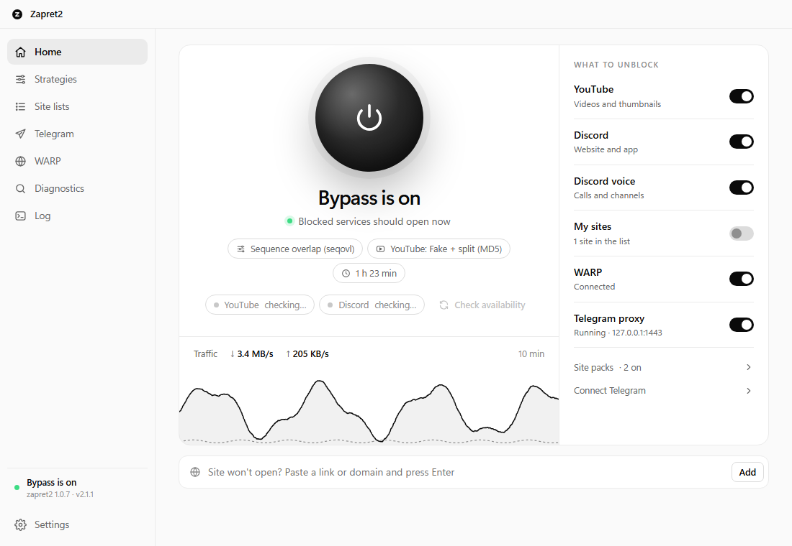
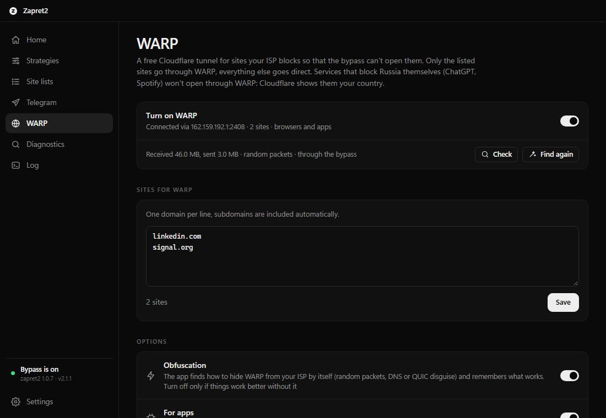
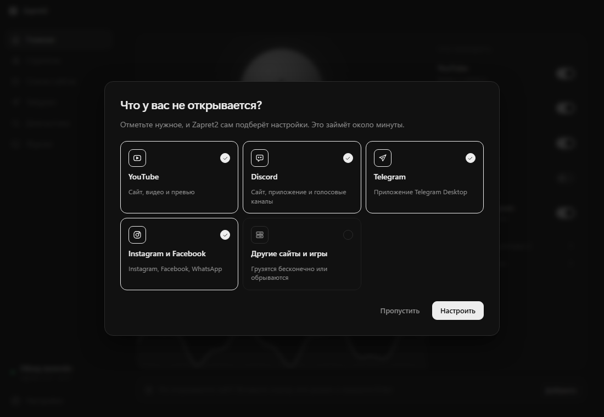
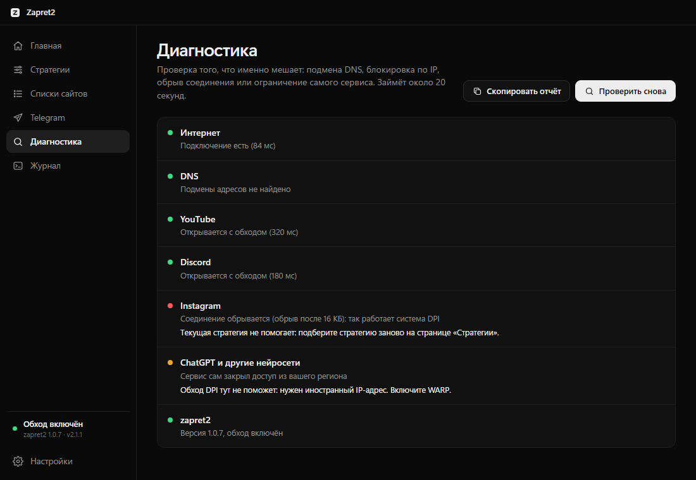
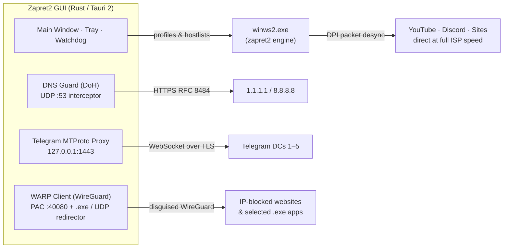

<picture>
  <source media="(prefers-color-scheme: dark)" srcset="gui/screenshots/banner-en-dark.svg">
  
</picture>

  

**[Features](#features)** · **[Screenshots](#screenshots)** · **[Comparison](#how-it-compares)** · **[Architecture](#how-it-works)** · **[Installation](#installation)** · **[Shortcuts](#quick-controls)** · **[FAQ](#faq)** · **[Русский](README.md)**

 

<picture>
  <source media="(prefers-color-scheme: dark)" srcset="gui/screenshots/main-en-dark.png">
  
</picture>

A fast, native Rust desktop app for <b>zapret2</b> featuring a built-in Cloudflare WARP split tunnel, Telegram Desktop MTProto proxy, transparent DNS-over-HTTPS guard, and automatic strategy discovery.

 

## Features

<table>
  <tr>
    <td width="33%" valign="top">
       
      <h3>One-click & global hotkey</h3>
      Click the sphere, middle-click the tray icon, or press <code>Ctrl+Shift+Z</code> over any window or game — YouTube, Discord, and your selected sites open at full native speed.
    </td>
    <td width="33%" valign="top">
       
      <h3>Smart strategy discovery</h3>
      Tests 10 DPI circumvention strategies against real endpoints and YouTube video redirectors (GGC), picks a dedicated Google strategy, and detects when QUIC should be turned off.
    </td>
    <td width="33%" valign="top">
       
      <h3>Watchdog & network memory</h3>
      Checks availability every 15 minutes and re-picks automatically if your ISP alters DPI rules. Remembers working strategies per network (home Wi-Fi vs. mobile hotspot) with instant rollback.
    </td>
  </tr>
  <tr>
    <td width="33%" valign="top">
       
      <h3>WARP for sites & .exe apps</h3>
      Built-in userspace WireGuard client with automatic DPI disguise. Routes only selected domains or entire desktop apps (<code>.exe</code>), including voice and game UDP traffic.
    </td>
    <td width="33%" valign="top">
       
      <h3>Telegram, zero setup</h3>
      Native local MTProto-over-WebSocket proxy with automatic Cloudflare fallback. Click “Connect in Telegram” once and Telegram Desktop works even where direct DC connections are blocked.
    </td>
    <td width="33%" valign="top">
       
      <h3>Diagnostics & DNS Guard</h3>
      Pinpoints DNS poisoning, 16 KB DPI cutoffs, IP blocks, or geo-restrictions in ~10 seconds — and enables built-in transparent DNS-over-HTTPS protection in one click.
    </td>
  </tr>
</table>

<b>Everything inside — full feature breakdown</b>

 

**DPI Circumvention (`winws2`)**
- Ready-to-use profiles for **YouTube** (TCP + QUIC), **Discord**, **Discord Voice** (`STUN` / `IP Discovery`), and **My Sites**.
- **10 curated strategies** (including TLS mutation `rnd,dupsid`, `syndata`, `seqovl`, `autottl`, `badseq`, `tcp_md5`, `tcp_ts`) plus custom `--lua-desync` options.
- **10 one-click site packs:** Telegram, Instagram & Facebook, X (Twitter), torrent trackers, Roblox, Signal, LinkedIn, Twitch, Games & Launchers (Steam, Epic Games, Riot, Ubisoft, EA, GOG, FACEIT), and ~16,300 foreign hosting/CDN subnets (Cloudflare, Hetzner, DigitalOcean, OVH, AWS).
- **Three “My Sites” modes:** list only, list + automatic broken-host discovery (`autohostlist`), or all sites except exclusions.
- Automatic IDN / Punycode normalization for internationalized domains (`.рф`, etc.) and clean URL stripping.
- Strict QUIC drop rules (`--lua-desync=drop`) across YouTube, Discord, and custom lists when QUIC is toggled off.

**Built-in Cloudflare WARP (Split Tunnel)**
- Pure Rust userspace WireGuard stack (`boringtun` + `smoltcp`) — no virtual TUN adapters or background system services installed.
- **Automatic handshake obfuscation:** random junk packets, DNS/QUIC disguise, and routing through the active `winws2` bypass.
- **Granular split routing:** browsers receive an automatic PAC script for listed domains only, while selected `.exe` applications (picked from running processes) and voice/game UDP flows are transparently redirected via WinDivert socket/network layers.
- Supports **WARP+** license keys and one-click WireGuard account re-issuance.

**DNS Protection & Interactive Diagnostics**
- **Transparent DoH Guard:** intercepts outbound `UDP:53` queries via WinDivert and resolves them over RFC 8484 HTTPS (`1.1.1.1` & `8.8.8.8`) with an in-memory TTL cache — without altering Windows adapter settings.
- **Actionable diagnostics:** parallel probes with direct fix buttons (*Turn bypass on*, *Find a strategy*, *Turn on DNS protection*, *Open WARP*).
- When a single-site check detects an IP block where no DPI strategy works, a **“Route through WARP”** button appears immediately.

**Native Craft, Zero Idle GPU & Portability**
- Strict monochrome design without `backdrop-filter: blur` or idle animations: **0% GPU load** while minimized to the tray.
- Direct Win32 API integration (`CreateToolhelp32Snapshot`, `RegGetValueW`, `IdnToAscii`, `RegisterHotKey`) with zero hidden console flashes.
- **Tray flyout** with 6 quick-toggle service tiles, strategy selector, and one-click strategy search.
- **JSON Backup Export/Import** and **Portable Mode** (place an empty `portable` file next to the executable).
- Three independent signed/verified auto-update channels: app binary, `zapret2` engine (SHA-256 verified), and cloud presets/lists.
- Supports Windows 10 & 11 on both **x64** and **ARM64 (Snapdragon)**.

## Screenshots

<table>
  <tr>
    <td width="50%"></td>
    <td width="50%"></td>
  </tr>
  <tr>
    <td align="center"><b>Cloudflare WARP</b> split tunnel for blocked sites and .exe apps</td>
    <td align="center"><b>Strategy discovery</b> separate scoring for YouTube, GGC, and other sites</td>
  </tr>
  <tr>
    <td></td>
    <td></td>
  </tr>
  <tr>
    <td align="center"><b>First-run wizard</b> tick what doesn't open and let it configure itself</td>
    <td align="center"><b>Interactive diagnostics</b> exact root cause and one-click fix actions</td>
  </tr>
</table>

The interface automatically matches your Windows display language (English or Russian) and can be switched anytime in Settings → Appearance.

## How it compares

Under the hood, DPI desynchronization is powered by [zapret2](https://github.com/bol-van/zapret2) by **bol-van**, paired with native Rust networking subsystems:

| Capability | **Zapret2 GUI** | zapret-discord-youtube | GoodbyeDPI |
| :-- | :-: | :-: | :-: |
| Interface & control | Native window, tray flyout, `Ctrl+Shift+Z` | `.bat` scripts & console | `.cmd` scripts & console |
| Automatic strategy discovery | ✓ split YouTube + auto QUIC fallback | Console test, manual `.bat` pick | Manual flag tuning |
| Auto-recovery when ISP changes DPI | ✓ background watchdog + rollback | — | — |
| Per-network strategy memory | ✓ automatic switching + history | — | — |
| Built-in Cloudflare WARP split tunnel | ✓ domains + `.exe` apps + UDP | — | — |
| Built-in Telegram Desktop proxy | ✓ local MTProto-over-WS | — | — |
| Built-in anti-spoofing DNS protection | ✓ transparent DoH (`1.1.1.1` / `8.8.8.8`) | — | — |
| Root-cause diagnostics | ✓ DNS / 16 KB DPI / IP block / geo | Conflict check only | — |
| Portable mode & JSON backup | ✓ built in | Script folder | Script folder |
| Updates (app, engine, strategies, lists) | ✓ automatic & cryptographically verified | Manual archive download | Manual download |

Already running another zapret script pack or GoodbyeDPI? Zapret2 GUI detects it cleanly, lets WARP and Telegram run alongside it right away, and offers to import your domain lists and safely pause the old Windows service (restorable in one click) when enabling its own bypass.

## How it works

Zapret2 GUI orchestrates **four independent networking engines** that can run together or individually:

1. **DPI Desynchronization (`winws2`).** Alters only the initial handshake packets (SNI splitting, auto-TTL/MD5/timestamp fakes, `seqovl` overlap). Media streams, downloads, and game packets flow **directly at 100% of your line speed**.
2. **DNS Guard (`DoH`).** Transparently intercepts outbound `UDP:53` queries via WinDivert and resolves them over HTTPS (`1.1.1.1` / `8.8.8.8`), defeating ISP DNS spoofing without touching Windows network settings.
3. **WARP Split Tunnel.** Websites blocked outright by IP — or specific `.exe` desktop apps and their UDP voice/game ports — are routed through a disguised userspace WireGuard tunnel to Cloudflare.
4. **Telegram Proxy.** Wraps MTProto traffic inside standard TLS WebSocket streams (`wss://kws*.web.telegram.org/apiws`) with automatic fallback relays.

## Installation

<table>
  <tr>
    <td width="33%" valign="top">
      <h3>1 · Download</h3>
      Grab <code>Zapret2.GUI_X.Y.Z_x64-setup.exe</code> from the <a href="https://github.com/raiyaxkrash/zapret2-rust/releases/latest">latest release</a>.
    </td>
    <td width="33%" valign="top">
      <h3>2 · Launch</h3>
      Approve administrator privileges — Windows requires elevation to load the kernel packet driver.
    </td>
    <td width="33%" valign="top">
      <h3>3 · Select services</h3>
      Tick what doesn't open in the setup wizard and click <b>“Set up”</b>. Everything is ready in under a minute.
    </td>
  </tr>
</table>

> [!TIP]
> **Portable Mode:** Create an empty `portable` or `portable.txt` file next to `zapret2-gui.exe`. All settings, lists, WARP keys, and downloaded engine binaries will stay inside a local `data\` subfolder.

> [!NOTE]
> **Antivirus false positives.** The signed `WinDivert64.sys` kernel packet driver (the exact same driver used by GoodbyeDPI and zapret builds) is occasionally flagged by heuristic scanners as a `RiskTool` / `PUA`. [VirusTotal report](https://www.virustotal.com/gui/file/a7f73e997a1ea0374df15f16ac98f4400e6b81aabc377842ca2f31cc8728e76f): Microsoft Defender, ESET, Dr.Web, BitDefender, and Malwarebytes report zero threats. Every installer is built reproducibly on [GitHub Actions](https://github.com/raiyaxkrash/zapret2-rust/actions).

## Quick controls

| Action | Shortcut / Gesture |
| :--- | :--- |
| Toggle bypass over any window or game | **`Ctrl + Shift + Z`** *(configurable in Settings → Startup)* |
| Open the tray flyout with 6 service tiles | **Left-click** the Zapret2 tray icon |
| Toggle bypass instantly from the tray | **Middle-click** the Zapret2 tray icon |
| Open the main window from the tray | **Double-click** the Zapret2 tray icon |
| Save active list or custom options | **`Ctrl + S`** on Site Lists, WARP, or Strategies pages |
| Filter log entries | **`Ctrl + F`** on the Log page |

## FAQ

<b>YouTube loads the page, but videos buffer endlessly</b>

Google's regional video caches (`*.googlevideo.com`) often block QUIC (`UDP:443`) or require a different strategy than `youtube.com`. Run **“Find automatically”** on the Strategies page (or re-run the Setup Wizard) — it probes video redirectors directly and automatically turns off **QUIC / HTTP3** when needed.

<b>A website is IP-blocked and no DPI strategy opens it</b>

Paste the link into **“Check a site”** on the Strategies page. When all DPI strategies fail, click **“Route through WARP”** right in the result bar to send that domain through the Cloudflare tunnel while keeping everything else direct.

<b>How do I route a specific desktop app or game (.exe) through WARP?</b>

Open **WARP** → **Apps for WARP**, pick the app from **“Running apps…”** (or enter `appname.exe`). All TCP and voice/game UDP traffic from that executable will flow through WARP regardless of domain lists.

<b>ChatGPT, Claude, or Spotify say they aren't available in my country</b>

Those services restrict certain countries themselves and verify your country by IP. Neither DPI circumvention nor free Cloudflare WARP masks your country code (Cloudflare passes your real country via geo headers/ranges). Use a foreign VPN for geo-blocked services.

<b>Where are the Strategies, Log, and custom port settings?</b>

Enable **Settings → Appearance → Expert mode** to unlock the Strategies page, live filterable Log, custom `--lua-desync` fields, WARP+ license binding, and proxy port controls.

Didn't find an answer? [Open an issue](https://github.com/raiyaxkrash/zapret2-rust/issues/new/choose) with a copied diagnostics report, or follow release updates on Telegram at [@raygit](https://t.me/raygit).

## Credits

- [**zapret2**](https://github.com/bol-van/zapret2) and [zapret-win-bundle](https://github.com/bol-van/zapret-win-bundle) by **bol-van** — `winws2` DPI engine, Lua desync scripts, and ARM64 driver bundle (MIT).
- [**tg-ws-proxy**](https://github.com/Flowseal/tg-ws-proxy) by **Flowseal** — protocol design behind the built-in Telegram WebSocket proxy (MIT).
- [WinDivert](https://reqrypt.org/windivert.html) — Windows packet interception driver · [Tauri 2](https://tauri.app) — desktop framework · [Cloudflare WARP](https://one.one.one.one/) — WireGuard edge network.

 

 
Crafted with care for people who just want things to open.

