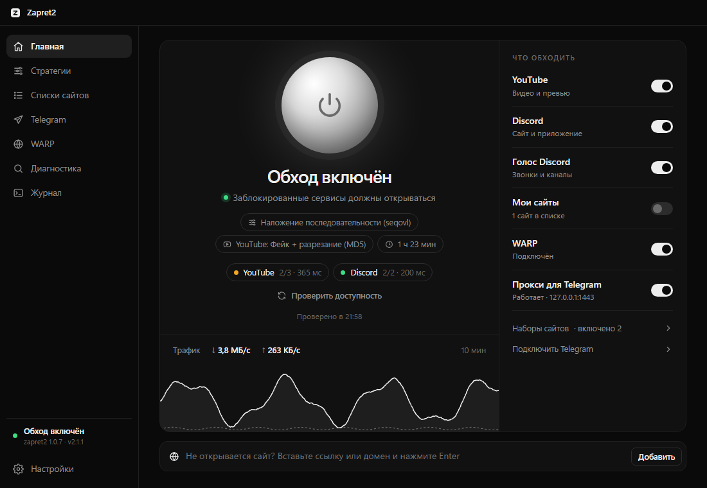

# Zapret2 GUI

**YouTube, Discord, Telegram and other blocked sites on Windows — in one click**

A simple desktop app for [zapret2](https://github.com/bol-van/zapret2) (DPI circumvention by bol-van): one button, setup wizard, automatic strategy search, a built-in proxy for Telegram Desktop, ready-made site packs and auto-updates.

[Русский](README.md)

### [⬇ Download the latest version](https://github.com/raiyaxkrash/zapret2-rust/releases/latest)

> [!NOTE]
> The interface is currently in Russian only. The app is fully usable without reading much: the big sphere turns circumvention on and off, and the setup wizard does the rest.

## Features

- **One button.** Click the sphere on the main screen or use the tray mini-window.
- **Setup wizard.** Pick what doesn't open (YouTube, Discord, Telegram, Instagram, other sites and games) and the app configures itself in about a minute.
- **Automatic strategy search.** Every strategy is tried in turn and checked against real sites (at least 64 KB is downloaded to catch the "16 KB freeze"). YouTube gets its own strategy.
- **Telegram Desktop proxy.** A built-in local MTProto proxy (Rust re-implementation of the [tg-ws-proxy](https://github.com/Flowseal/tg-ws-proxy) protocol) that routes Telegram over WebSocket/TLS. Connect with one click.
- **Site packs:** Telegram, Instagram & Facebook, X (Twitter), torrent trackers, Roblox, Signal, LinkedIn.
- **Foreign hosting & CDN pack.** ~16,000 subnets of Cloudflare, Hetzner, DigitalOcean, OVH, AWS, Google Cloud, Oracle and others for sites and games that hang or break mid-download.
- **ISP hint.** The app detects your ISP and suggests a strategy known to work there; you can share your result to help others.
- **Check any site:** paste a link to see whether it opens without circumvention and with which strategies.
- **Live status:** service availability and a 10-minute traffic chart on the main screen.
- **Reliable:** winws2 is restarted if it crashes and never left running after exit.
- **Auto-updates** for the app, strategies, site lists and zapret2 itself.
- **Starts with Windows** without a UAC prompt on every login.
- **Strict black-and-white design**, dark and light themes.
- **Windows 11 on ARM64** supported.

## Installation

1. Download `Zapret2.GUI_X.Y.Z_x64-setup.exe` from the [releases page](https://github.com/raiyaxkrash/zapret2-rust/releases/latest).
2. Run the installer and allow administrator rights (required to load the WinDivert driver).
3. The setup wizard opens on first launch: tick what doesn't work and press «Настроить» (Set up).

Antivirus software sometimes flags the WinDivert driver: it is a packet interception driver, not malware. Installers are built by GitHub Actions from the open source code in this repository — see the [Actions](https://github.com/raiyaxkrash/zapret2-rust/actions) tab for every build log. [VirusTotal scan of 2.0.0](https://www.virustotal.com/gui/file/a7f73e997a1ea0374df15f16ac98f4400e6b81aabc377842ca2f31cc8728e76f): 14 of 65 engines react to the WinDivert driver (`pua.windivert`, `RiskTool.WinDivert`) or generic heuristics; Microsoft Defender, ESET, Dr.Web, BitDefender and Malwarebytes report it clean.

## Credits and license

- [zapret2](https://github.com/bol-van/zapret2) by **bol-van** — the circumvention engine (MIT).
- [tg-ws-proxy](https://github.com/Flowseal/tg-ws-proxy) by **Flowseal** — the protocol the Telegram proxy is based on (MIT).
- [WinDivert](https://reqrypt.org/windivert.html) — packet interception driver.
- [Tauri](https://tauri.app) — application framework.
