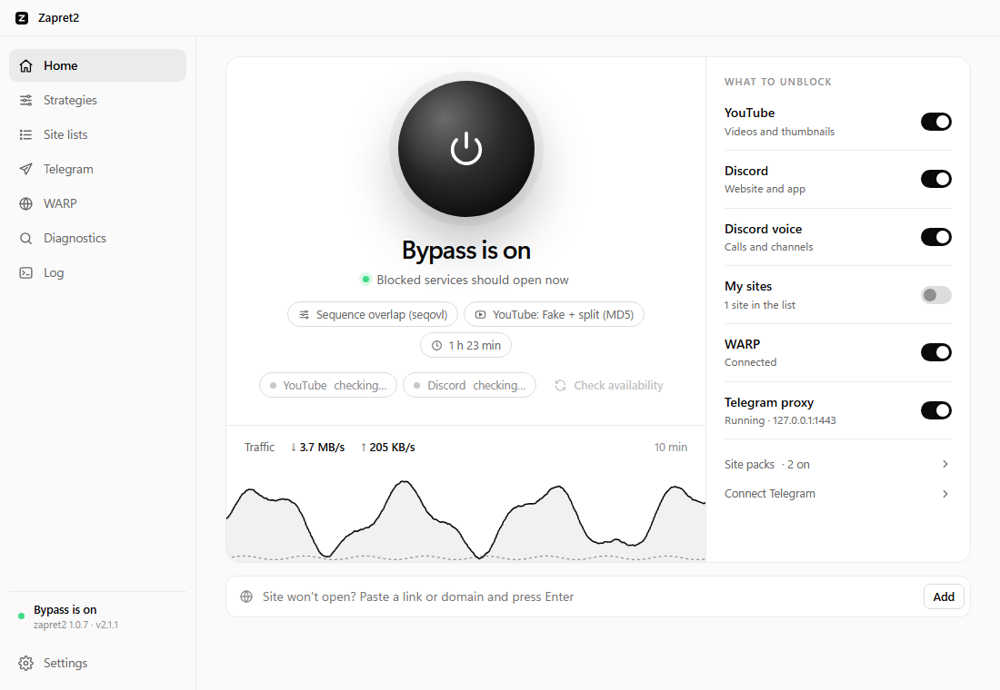
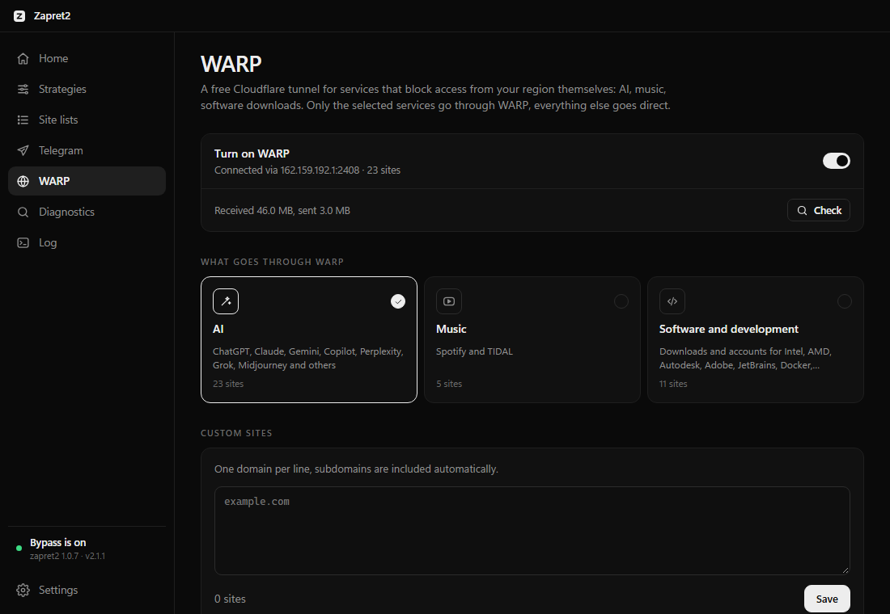

<picture>
  <source media="(prefers-color-scheme: dark)" srcset="gui/screenshots/logo-dark.svg">
  
</picture>

# Zapret2 GUI

**YouTube, Discord, Telegram, ChatGPT and other blocked sites on Windows — in one click.** 
Install it, tick what doesn't open, and the app takes care of the rest.

[Features](#features) · [Installation](#installation) · [Русский](README.md)

 

<picture>
  <source media="(prefers-color-scheme: dark)" srcset="gui/screenshots/main-en-dark.png">
  
</picture>

<table>
  <tr>
    <td width="33%" valign="top">
      <h3>One button</h3>
      Click the sphere and blocked services open. Click again to turn it off. Also available from the tray mini-window.
    </td>
    <td width="33%" valign="top">
      <h3>Sets itself up</h3>
      The wizard asks what doesn't open and finds a working strategy for your ISP in about a minute. If the ISP changes its blocking, the app notices and re-tunes itself.
    </td>
    <td width="33%" valign="top">
      <h3>Telegram, no setup</h3>
      A built-in proxy for Telegram Desktop: one click on “Connect in Telegram” and the app works even where it can't connect directly.
    </td>
  </tr>
</table>

## Features

- **Services:** YouTube (incl. QUIC), Discord with voice, Telegram Desktop, plus one-click packs — Telegram, Instagram & Facebook, X, torrent trackers, Roblox, Signal, LinkedIn, games & launchers (Steam, Epic, Riot, Ubisoft, EA, GOG, FACEIT), Twitch.
- **Foreign hosting & CDN:** ~16,000 subnets of Cloudflare, Hetzner, DigitalOcean, OVH, AWS, Google Cloud, Oracle and others for sites and games that hang or break mid-download.
- **Built-in WARP** for services that block Russia themselves: ChatGPT, Claude, Gemini and other AI tools, Spotify, Intel/AMD/Adobe/JetBrains downloads. Only the selected sites go through the free Cloudflare tunnel; everything else stays direct. Nothing extra to install.
- **Automatic strategy search** against real sites, with a separate strategy for YouTube.
- **Watchdog:** checks services every 15 minutes and re-picks a strategy when the ISP changes its blocking.
- **Diagnostics:** tells DNS spoofing, IP blocking, DPI resets and service-side geo-restrictions apart, with advice for each.
- **Live status:** service availability and a 10-minute traffic chart on the main screen.
- **Auto-updates** for the app, strategies, site lists and zapret2 itself; starts with Windows; dark and light themes; English and Russian interface; ARM64 support.

## Installation

1. **Download** `Zapret2.GUI_X.Y.Z_x64-setup.exe` from the [releases page](https://github.com/raiyaxkrash/zapret2-rust/releases/latest).
2. **Run** the installer and allow administrator rights (required to load the network driver).
3. **Tick** what doesn't open in the wizard and press “Set up”. Done.

The interface follows your Windows language; you can switch it in Settings → Appearance → Language.

On first launch the app downloads [zapret2](https://github.com/bol-van/zapret2) from GitHub and verifies it with checksums.

> [!NOTE]
> **Antivirus warnings?** The app uses the WinDivert packet driver — the same as GoodbyeDPI and zapret builds — which some engines flag as “potentially unwanted”. [VirusTotal scan](https://www.virustotal.com/gui/file/a7f73e997a1ea0374df15f16ac98f4400e6b81aabc377842ca2f31cc8728e76f): Microsoft Defender, ESET, Dr.Web, BitDefender and Malwarebytes report it clean. Installers are built by GitHub Actions from this repository's open source code — see the [Actions](https://github.com/raiyaxkrash/zapret2-rust/actions) tab.

## Credits

- [**zapret2**](https://github.com/bol-van/zapret2) and [zapret-win-bundle](https://github.com/bol-van/zapret-win-bundle) by **bol-van** — the circumvention engine and ARM64 driver (MIT).
- [**tg-ws-proxy**](https://github.com/Flowseal/tg-ws-proxy) by **Flowseal** — the protocol behind the Telegram proxy (MIT).
- [WinDivert](https://reqrypt.org/windivert.html) — packet interception driver. [Tauri](https://tauri.app) — application framework.
