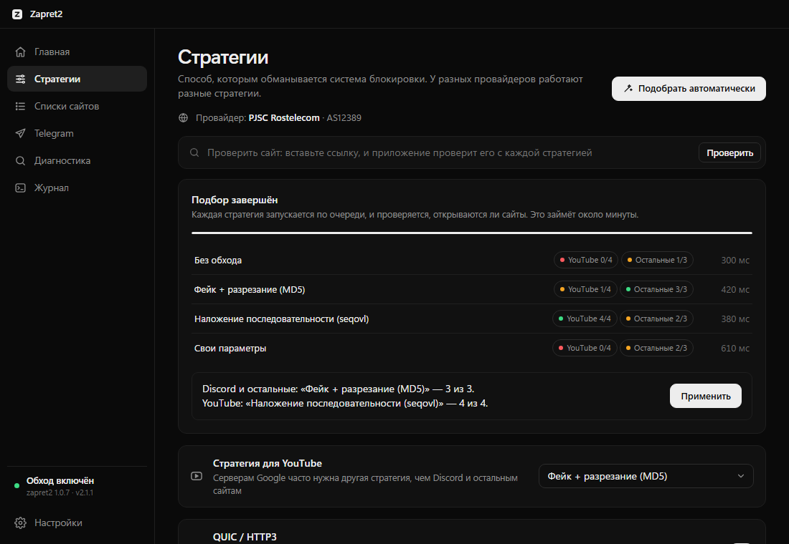
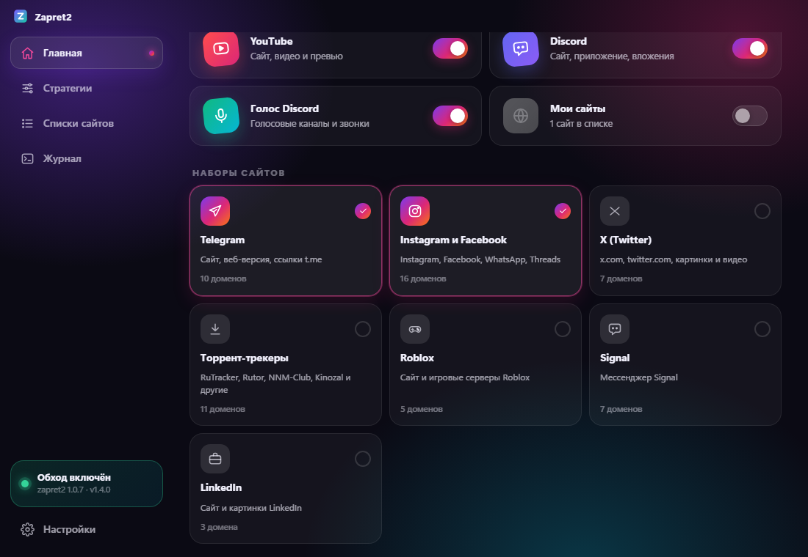
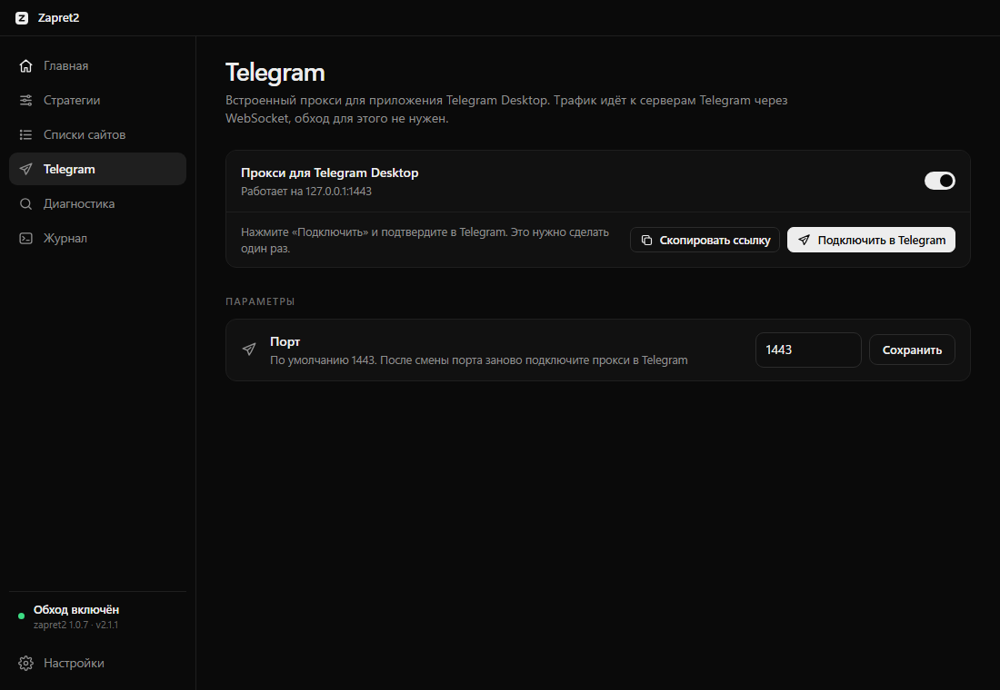
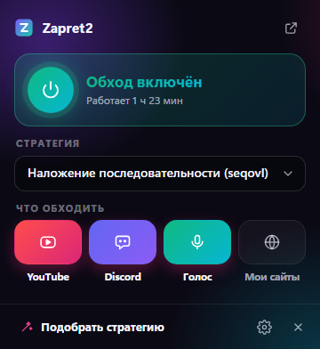
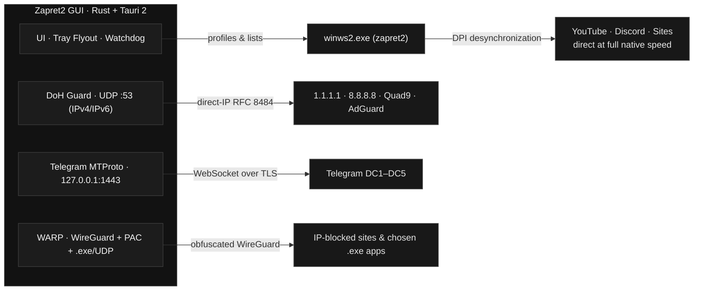

<div align="center">

<picture>
  <source media="(prefers-color-scheme: dark)" srcset="gui/screenshots/banner-en-dark.svg">
  
</picture>

<br><br>

<p>
  <a href="https://github.com/raiyaxkrash/zapret2-rust/releases/latest">
    
  </a>
  &nbsp;
  <a href="https://t.me/raygit">
    
  </a>
</p>

<p>
  <a href="https://github.com/raiyaxkrash/zapret2-rust/releases/latest"></a>
  <a href="https://github.com/raiyaxkrash/zapret2-rust/tree/stats"></a>
  <a href="https://github.com/raiyaxkrash/zapret2-rust/actions"></a>
  <a href="gui/"></a>
  <a href="https://github.com/raiyaxkrash/zapret2-rust/stargazers"></a>
</p>

<br>

<sub>
  <a href="#features"><b>Features</b></a> &nbsp;·&nbsp;
  <a href="#interface"><b>Interface</b></a> &nbsp;·&nbsp;
  <a href="#architecture"><b>Architecture</b></a> &nbsp;·&nbsp;
  <a href="#comparison"><b>Comparison</b></a> &nbsp;·&nbsp;
  <a href="#quick-start"><b>Quick Start</b></a> &nbsp;·&nbsp;
  <a href="#controls"><b>Controls</b></a> &nbsp;·&nbsp;
  <a href="#faq"><b>FAQ</b></a> &nbsp;·&nbsp;
  <a href="README.md"><b>Русский</b></a>
</sub>

<br><br>

<picture>
  <source media="(prefers-color-scheme: dark)" srcset="gui/screenshots/main-en-dark.png">
  
</picture>

<br><br>

<table>
  <tr>
    <td align="center" width="25%"><b>0% GPU</b><br><sub>while minimized to tray</sub></td>
    <td align="center" width="25%"><b>4 engines</b><br><sub>DPI · WARP · DoH · Telegram</sub></td>
    <td align="center" width="25%"><b>10 strategies</b><br><sub>+ named custom presets</sub></td>
    <td align="center" width="25%"><b>x64 & ARM64</b><br><sub>Windows 10 / 11 + Portable</sub></td>
  </tr>
</table>

<sub>A fast, native <b>Rust</b> desktop app for <b>zapret2</b>: full-speed DPI circumvention, built-in Cloudflare WARP split tunnel, Telegram Desktop MTProto proxy, IPv4/IPv6 DNS-over-HTTPS guard, and smart strategy discovery.</sub>

</div>

<br>

---

## Features

<table>
  <tr>
    <td width="33%" valign="top">
      <br>
      <h4>One-click & hotkey</h4>
      Click the sphere, middle-click the tray icon, or press <code>Ctrl+Shift+Z</code> over any game — sites open at full native speed.
    </td>
    <td width="33%" valign="top">
      <br>
      <h4>Smart strategy discovery</h4>
      Benchmarks 10 strategies on real endpoints and YouTube GGC nodes, catches 16 KB DPI cutoffs, and probes <b>QUIC (UDP 443)</b> directly.
    </td>
    <td width="33%" valign="top">
      <br>
      <h4>Watchdog & network memory</h4>
      Monitors reachability every 15 minutes and re-picks if ISP rules shift. Remembers separate profiles for home Wi-Fi and mobile hotspots.
    </td>
  </tr>
  <tr>
    <td width="33%" valign="top">
      <br>
      <h4>WARP for sites & .exe apps</h4>
      Pure Rust userspace WireGuard (<code>boringtun</code> + <code>smoltcp</code>) with automatic DPI disguise. Routes only listed domains or chosen <code>.exe</code> apps with UDP.
    </td>
    <td width="33%" valign="top">
      <br>
      <h4>Telegram, zero setup</h4>
      Built-in local MTProto-over-WebSocket proxy with automatic Cloudflare fallback. Connects Telegram Desktop in one click.
    </td>
    <td width="33%" valign="top">
      <br>
      <h4>Diagnostics & DoH Guard</h4>
      Pinpoints DNS spoofing, 16 KB DPI cutoffs, IP blocks, or geo-limits in ~10 seconds — and enables transparent <b>IPv4/IPv6 DoH</b> with selectable servers.
    </td>
  </tr>
</table>

<details>
<summary><b>Everything inside — full technical breakdown</b></summary>

<br>

**DPI Circumvention (`winws2`)**
- Dedicated profiles for **YouTube** (TCP + QUIC), **Discord**, **Discord Voice** (`STUN` / `IP Discovery`), and **My Sites**.
- **10 curated strategies** (`rnd,dupsid`, `syndata`, `seqovl`, `autottl`, `badseq`, `tcp_md5`, `tcp_ts`) plus **named custom `--lua-desync` presets**.
- **10 one-click site packs:** Telegram, Instagram/Facebook, X (Twitter), torrent trackers, Roblox, Signal, LinkedIn, Twitch, Games & Launchers (Steam, Epic, Riot, Ubisoft, EA, GOG, FACEIT), and ~16,300 hosting/CDN subnets (Cloudflare, Hetzner, DigitalOcean, OVH, AWS).
- **Three “My Sites” modes:** list only, automatic broken-host discovery (`autohostlist`), or all sites except exclusions, with automatic IDN Punycode normalization.
- Strict QUIC drop rules (`--lua-desync=drop`) whenever QUIC is toggled off.

**Built-in Cloudflare WARP (Split Tunnel)**
- Userspace WireGuard stack (`boringtun` + `smoltcp`) — zero virtual TUN drivers or background services installed.
- **Automatic handshake obfuscation:** junk packets, DNS/QUIC disguise, and routing through the active `winws2` bypass.
- **Granular split routing:** auto-generated PAC script for browsers + WinDivert redirection for selected `.exe` apps (TCP + voice/game UDP).
- Supports **WARP+** license keys and one-click WireGuard account re-issuance.

**DNS Protection (DoH Guard) & Diagnostics**
- Transparent `UDP:53` (**IPv4 + IPv6**) interception → direct-IP RFC 8484 DoH (`1.1.1.1`, `8.8.8.8`, Quad9 `9.9.9.9`, AdGuard `94.140.14.14`, or a custom HTTPS URL) with **RCODE/TTL-aware caching**, singleflight deduplication, and live counters.
- Actionable diagnostics with direct fix buttons and one-click WARP routing for IP-blocked domains.

**Native Craft & Portability**
- Monochrome UI without `backdrop-filter: blur` or idle GPU loops (**0% GPU** in tray).
- Direct Win32 API calls (`CreateToolhelp32Snapshot`, `RegGetValueW`, `IdnToAscii`, `RegisterHotKey`) — zero console flashes.
- **JSON Backup Export/Import** and **Portable Mode** (place an empty `portable` file next to the `.exe`).
- Three verified auto-update channels: signed app updates, SHA-256 verified `zapret2` engine, and cloud presets/lists.
</details>

<br>

---

## Interface

<table>
  <tr>
    <td width="50%"></td>
    <td width="50%"></td>
  </tr>
  <tr>
    <td align="center"><sub><b>Cloudflare WARP</b><br>split tunnel for blocked domains and <code>.exe</code> apps</sub></td>
    <td align="center"><sub><b>Strategy discovery</b><br>separate scoring for YouTube, GGC, QUIC, and other sites</sub></td>
  </tr>
  <tr>
    <td></td>
    <td></td>
  </tr>
  <tr>
    <td align="center"><sub><b>First-run wizard</b><br>pick what’s blocked and let Zapret2 configure itself</sub></td>
    <td align="center"><sub><b>Interactive diagnostics</b><br>exact root cause and one-click fix</sub></td>
  </tr>
  <tr>
    <td></td>
    <td></td>
  </tr>
  <tr>
    <td align="center"><sub><b>Site packs</b><br>one-click packs with domain inspection</sub></td>
    <td align="center"><sub><b>Telegram Desktop proxy</b><br>local MTProto-WS without external tools</sub></td>
  </tr>
</table>

<div align="center">
  <br>
  
  <br>
  <sub><b>System tray flyout</b> — 6 quick-toggle service tiles, strategy picker, and one-click auto-discovery</sub>
</div>

<br>

---

## Architecture

Four independent networking engines inside one native Rust binary — enable them individually or together:



1. **DPI Desynchronization (`winws2`)** — only touches initial handshake packets (SNI split, fakes, `seqovl`). All video, voice, and game traffic flows directly at full speed.
2. **DNS Protection (`DoH Guard`)** — transparently intercepts `UDP:53` (IPv4 + IPv6) and resolves via RFC 8484 DoH with TTL caching, without changing Windows adapter settings.
3. **Split Tunnel (`WARP`)** — sends only IP-blocked domains and chosen `.exe` apps through an encrypted WireGuard tunnel.
4. **Telegram Proxy** — wraps MTProto inside standard WebSocket-over-TLS with automatic fallback.

<br>

---

## Comparison

Built on top of **bol-van’s** [zapret2](https://github.com/bol-van/zapret2), extended with native Rust networking modules:

| Capability | **Zapret2 GUI** | zapret-discord-youtube | GoodbyeDPI |
| :--- | :---: | :---: | :---: |
| Control | Native UI, tray flyout, `Ctrl+Shift+Z` | Console `.bat` scripts | Console `.cmd` scripts |
| Auto strategy discovery + QUIC probe | ✓ separate YouTube scoring | Manual `.bat` selection | Manual flags |
| Background watchdog with rollback | ✓ | — | — |
| Per-network memory (Wi-Fi / hotspot) | ✓ | — | — |
| Built-in Cloudflare WARP (domains + `.exe` + UDP) | ✓ | — | — |
| Built-in Telegram Desktop proxy | ✓ | — | — |
| Transparent DNS Guard (DoH IPv4/IPv6) | ✓ selectable servers | — | — |
| Root-cause diagnostics (DNS / 16 KB DPI / IP / geo) | ✓ | Conflicts only | — |
| Portable mode & JSON backup | ✓ | Folder of scripts | Folder of scripts |
| Auto-updates (signed + SHA-256) | ✓ | Manual | Manual |

<br>

---

## Quick Start

<table>
  <tr>
    <td width="33%" valign="top">
      <h4>01 · Download</h4>
      Grab <code>Zapret2.GUI_X.Y.Z_x64-setup.exe</code> from the <a href="https://github.com/raiyaxkrash/zapret2-rust/releases/latest">latest release</a>.
    </td>
    <td width="33%" valign="top">
      <h4>02 · Launch</h4>
      Approve the UAC prompt — Windows requires administrator rights to load the WinDivert kernel driver.
    </td>
    <td width="33%" valign="top">
      <h4>03 · Pick services</h4>
      Select what’s blocked in the first-run wizard and click <b>Configure</b>. Done.
    </td>
  </tr>
</table>

> [!TIP]
> **Portable mode:** create an empty `portable` (or `portable.txt`) file next to `zapret2-gui.exe` to store all data, lists, WARP keys, and the engine inside a local `data\` folder.

> [!NOTE]
> **Antivirus & WinDivert:** `WinDivert64.sys` is officially signed for the Windows kernel (also used by GoodbyeDPI and Wireshark tools). Some AV engines flag packet filters generically as `RiskTool` / `PUA`. [VirusTotal report](https://www.virustotal.com/gui/file/a7f73e997a1ea0374df15f16ac98f4400e6b81aabc377842ca2f31cc8728e76f): Microsoft Defender, Kaspersky, Dr.Web, ESET, BitDefender, and Malwarebytes report clean. Every release is built transparently via [GitHub Actions](https://github.com/raiyaxkrash/zapret2-rust/actions).

<br>

---

## Controls

| Action | Shortcut / Gesture |
| :--- | :--- |
| Toggle bypass over any window | **`Ctrl + Shift + Z`** *(enable in Settings)* |
| Open quick tray flyout | **Left-click** the tray icon |
| Instant bypass toggle | **Middle-click** the tray icon |
| Open main window | **Double-click** the tray icon |
| Save active list or settings | **`Ctrl + S`** on Lists, WARP, or Strategies |
| Search event log | **`Ctrl + F`** on the Logs page |

<br>

---

## FAQ

<details>
<summary><b>YouTube loads, but videos buffer endlessly</b></summary>

Video streams come from regional Google caches (`*.googlevideo.com`) where QUIC (UDP 443) is often throttled. Run **Auto-find** on the Strategies page — it probes QUIC over UDP 443 and recommends turning off **QUIC / HTTP3** when needed.
</details>

<details>
<summary><b>A site is blocked by IP — no DPI strategy works</b></summary>

Test the domain in **Check a site** on the Strategies page. If no DPI strategy opens it, click **Route through WARP** to add it to the Cloudflare WARP split tunnel without slowing down other sites.
</details>

<details>
<summary><b>How do I route a specific game or app through WARP?</b></summary>

Open **WARP → Apps for WARP**, pick the app from **From running…**, or type its `.exe` name (e.g. `discord.exe`). All TCP and voice/game UDP traffic for that process goes through WARP.
</details>

<details>
<summary><b>Where are Strategies, Logs, and custom presets?</b></summary>

Enable **Settings → Appearance → Expert mode** to unlock Strategies (including saving multiple named custom presets), Logs, and advanced parameters.
</details>

<details>
<summary><b>Windows 11 ARM64 (Snapdragon) support</b></summary>

Zapret2 GUI automatically installs the ARM64 `WinDivert64.sys` driver. Disable Secure Boot in UEFI and click **Enable test mode** on the home screen.
</details>

<details>
<summary><b>Building from source</b></summary>

See [**`gui/README.md`**](gui/README.md) for full architecture notes and release docs.

```powershell
cd gui
npm install
node scripts/check-i18n.mjs
cd src-tauri && cargo clippy --lib --tests -- -D warnings && cargo test --lib && cd ..
npm run build
```
</details>

<br>

---

<div align="center">

<sub>
  Powered by <a href="https://github.com/bol-van/zapret2">zapret2</a> (bol-van, MIT) ·
  <a href="https://github.com/Flowseal/tg-ws-proxy">tg-ws-proxy</a> (Flowseal, MIT) ·
  <a href="https://reqrypt.org/windivert.html">WinDivert</a> ·
  <a href="https://tauri.app">Tauri 2</a> ·
  <a href="https://one.one.one.one/">Cloudflare WARP</a>
</sub>

<br><br>


<br>

<sub>Crafted with care for people who just want the web to open.</sub>

</div>
