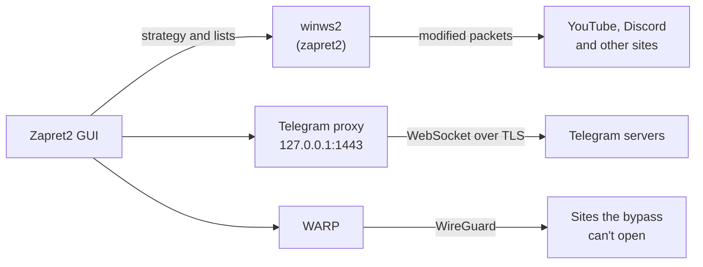

<picture>
  <source media="(prefers-color-scheme: dark)" srcset="gui/screenshots/banner-en-dark.svg">
  
</picture>

  

**[Features](#features)** · **[Comparison](#how-it-compares)** · **[Installation](#installation)** · **[FAQ](#faq)** · **[Русский](README.md)**

 

<picture>
  <source media="(prefers-color-scheme: dark)" srcset="gui/screenshots/main-en-dark.png">
  
</picture>

Install it, tick what doesn't open, and the app takes care of the rest.

 

## Features

<table>
  <tr>
    <td width="33%" valign="top">
       
      <h3>One button</h3>
      Click the sphere and YouTube, Discord and your chosen sites open. Click again and everything is back as it was. Also available from the tray mini window.
    </td>
    <td width="33%" valign="top">
       
      <h3>Sets itself up</h3>
      The wizard asks what doesn't open and finds a working strategy for your ISP in about a minute. If the ISP changes its blocking, the watchdog notices and finds a new one.
    </td>
    <td width="33%" valign="top">
       
      <h3>Remembers every network</h3>
      Home Wi-Fi needs one strategy, a phone hotspot another. Switch networks and the right one turns on by itself; earlier ones can be restored from history.
    </td>
  </tr>
  <tr>
    <td width="33%" valign="top">
       
      <h3>WARP tunnel</h3>
      For sites your ISP blocks so that the bypass can't open them. Only the selected sites go through the tunnel, in browsers and in desktop apps.
    </td>
    <td width="33%" valign="top">
       
      <h3>Telegram, no setup</h3>
      A built-in proxy for Telegram Desktop. One click on “Connect in Telegram” and the app works even where it can't connect directly.
    </td>
    <td width="33%" valign="top">
       
      <h3>See what's going on</h3>
      Service availability and a traffic chart on the main screen. Diagnostics tells you what's in the way: DNS spoofing, IP blocking or the service itself.
    </td>
  </tr>
</table>

<b>Everything inside</b>

 

**Unblocks**
- YouTube (incl. QUIC), Discord with voice channels, Telegram Desktop.
- One-click site packs: Telegram, Instagram & Facebook, X (Twitter), torrent trackers, Roblox, Signal, LinkedIn, games & launchers (Steam, Epic Games, Riot, Ubisoft, EA, GOG, FACEIT), Twitch.
- Foreign hosting & CDN: ~16,000 subnets of Cloudflare, Hetzner, DigitalOcean, OVH, AWS and others for sites and games that hang or break mid-download.
- Any site of your own: paste a link and it's added.
- Through WARP: any of your own sites the bypass can't open. WARP finds a way your ISP lets through by itself.

**Looks after itself**
- Strategy search against real sites, with a separate strategy for YouTube.
- The watchdog checks services every 15 minutes and re-picks a strategy; if the new one is worse, it restores the previous one.
- Per-network strategies and ISP hints built from other users' reports.

**Convenient**
- Updates itself, strategies, site lists and zapret2.
- Starts with Windows without an admin prompt at every sign-in; tray mini window.
- Simple mode for newcomers; everything else lives in Expert mode.
- Works alongside zapret-discord-youtube and GoodbyeDPI and imports your lists from them.
- Strict black-and-white design, dark and light themes, English and Russian interface.
- Windows 10 and 11, including ARM64 (Snapdragon).

## Screenshots

<table>
  <tr>
    <td width="50%"></td>
    <td width="50%"></td>
  </tr>
  <tr>
    <td align="center"><b>WARP</b> a tunnel for blocked sites</td>
    <td align="center"><b>Strategy search</b> YouTube and other services separately</td>
  </tr>
  <tr>
    <td></td>
    <td></td>
  </tr>
  <tr>
    <td align="center"><b>Setup wizard</b> tick what doesn't open</td>
    <td align="center"><b>Diagnostics</b> what's in the way and what to do</td>
  </tr>
</table>

Some screenshots show the Russian interface; the app switches to English automatically on English Windows.

## How it compares

Under the hood it's the same [zapret2](https://github.com/bol-van/zapret2) by bol-van used by popular builds. The difference is how much you have to do by hand.

| | **Zapret2 GUI** | zapret-discord-youtube | GoodbyeDPI |
| :-- | :-: | :-: | :-: |
| How you control it | window and tray | `.bat` files and console | `.cmd` files and console |
| Strategy choice | finds and applies one itself | console test, you pick the `.bat` | you pick the mode |
| Re-picks when the ISP changes blocking | ✓ watchdog | — | — |
| Separate strategy per network | ✓ | — | — |
| WARP tunnel for blocked sites | ✓ built in | — | — |
| Telegram Desktop proxy | ✓ built in | — | — |
| Diagnostics: what's wrong and what to do | ✓ | conflict check | — |
| Updates | automatic: app, strategies, lists | version check, manual download | manual |

Already using one of them? Zapret2 GUI works alongside: WARP and the Telegram proxy are available right away, and when you turn on its bypass it offers to disable the other program's service (restorable) and imports your site lists.

## Installation

<table>
  <tr>
    <td width="33%" valign="top">
      <h3>1 · Download</h3>
      <code>Zapret2.GUI_X.Y.Z_x64-setup.exe</code> from the <a href="https://github.com/raiyaxkrash/zapret2-rust/releases/latest">releases page</a>.
    </td>
    <td width="33%" valign="top">
      <h3>2 · Run</h3>
      Allow administrator rights: without them Windows won't load the network driver.
    </td>
    <td width="33%" valign="top">
      <h3>3 · Tick</h3>
      What doesn't open, and press “Set up”. A minute later everything works.
    </td>
  </tr>
</table>

The interface follows your Windows language; you can switch it in Settings → Appearance → Language. On first launch the app downloads [zapret2](https://github.com/bol-van/zapret2) from GitHub and verifies it with checksums.

> [!NOTE]
> **Antivirus warnings?** The app uses the WinDivert packet driver — the same as GoodbyeDPI and zapret builds — which some engines flag as “potentially unwanted”. [VirusTotal scan](https://www.virustotal.com/gui/file/a7f73e997a1ea0374df15f16ac98f4400e6b81aabc377842ca2f31cc8728e76f): Microsoft Defender, ESET, Dr.Web, BitDefender and Malwarebytes report it clean. Installers are built by GitHub Actions from this repository's open source code — see the [Actions](https://github.com/raiyaxkrash/zapret2-rust/actions) tab.

## How it works

- **Bypass.** zapret2 slightly alters the first packets of a connection so the ISP's blocking system stops recognizing them. Sites open directly: no VPN, no speed loss.
- **Telegram.** A separate built-in proxy carries Telegram Desktop traffic over WebSocket; no bypass needed.
- **WARP.** Sites your ISP blocks outright go through the free Cloudflare tunnel. The app finds how to hide WARP from the ISP by itself and checks that data really flows through the tunnel. Browsers learn about it from the system proxy settings, and desktop apps' connections are intercepted by the same driver zapret2 uses.

## FAQ

<b>ChatGPT, Claude or Spotify say they're unavailable in my country</b>

These services block Russia themselves and check your country by IP. A DPI bypass won't help, and neither will WARP: Cloudflare deliberately shows sites the user's real country. You need a VPN with a server abroad. Zapret2 GUI works alongside it, though with the VPN on you don't need the bypass: traffic already leaves the country.

<b>I already have zapret-discord-youtube or GoodbyeDPI</b>

Two DPI bypasses can't run at once: every packet would be modified twice. Zapret2 GUI works alongside them, with WARP and the Telegram proxy available right away. When you turn on the Zapret2 bypass, it offers to disable the other program's service (it stops starting with Windows) and imports your site lists. You can restore the service in Settings → Advanced.

<b>Something doesn't open and I don't know why</b>

Open Diagnostics → Check. The app shows what exactly is in the way (DNS spoofing, IP blocking, dropped connections or a restriction by the service itself) and what to do. You can copy the report and attach it to an issue.

<b>Where are the strategies and the log?</b>

New users see the simple mode: Home, site packs, Telegram, WARP and Diagnostics. Strategies, the log, ports and other fine-tuning appear when you turn on Settings → Appearance → “Expert mode”.

<b>Why does it need administrator rights?</b>

zapret2 intercepts network packets through the WinDivert driver, and only an administrator can load drivers in Windows. Autostart uses Task Scheduler, so there's no UAC prompt at every sign-in.

Didn't find an answer? [Open an issue](https://github.com/raiyaxkrash/zapret2-rust/issues/new/choose) and attach the diagnostics report. News and release announcements are posted in the Telegram channel [@raygit](https://t.me/raygit).

## Credits

- [**zapret2**](https://github.com/bol-van/zapret2) and [zapret-win-bundle](https://github.com/bol-van/zapret-win-bundle) by **bol-van** — the circumvention engine and ARM64 driver (MIT).
- [**tg-ws-proxy**](https://github.com/Flowseal/tg-ws-proxy) by **Flowseal** — the protocol behind the Telegram proxy (MIT).
- [WinDivert](https://reqrypt.org/windivert.html) — packet interception driver. [Tauri](https://tauri.app) — application framework. [Cloudflare WARP](https://one.one.one.one/) — the free tunnel.

 

 
Made for people who just want things to open.

