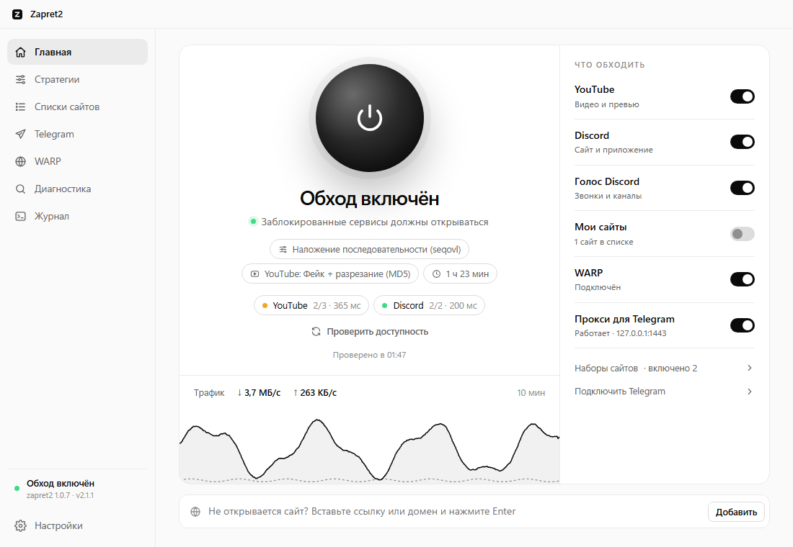
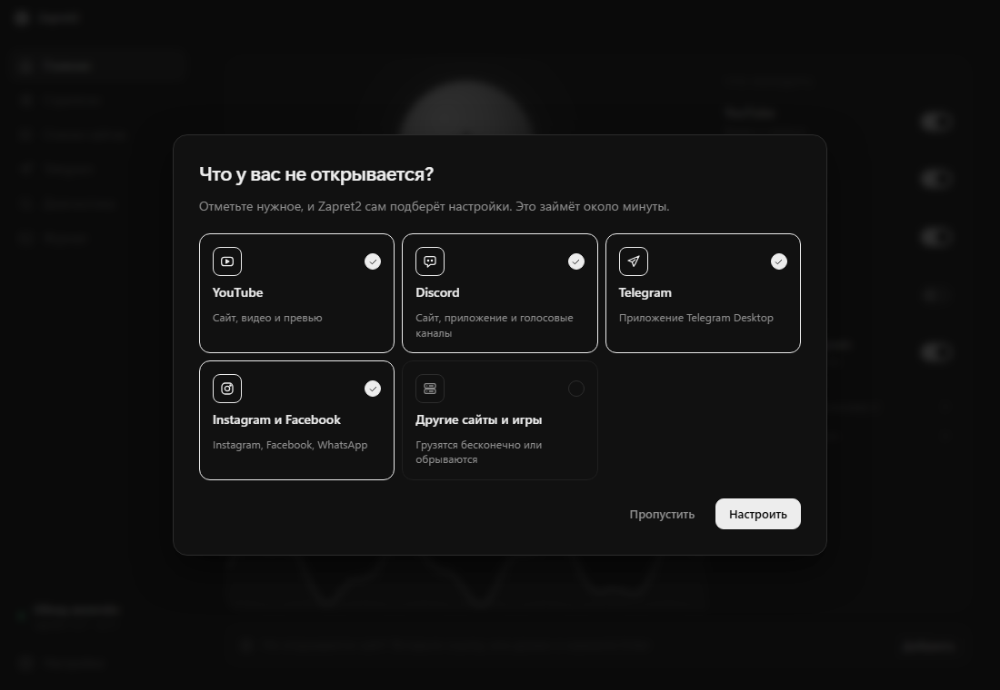
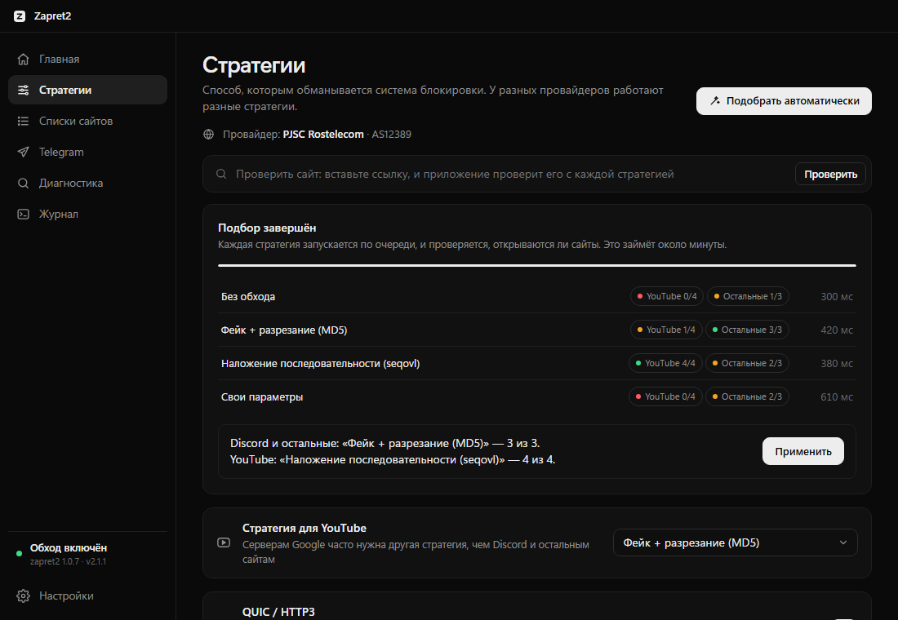
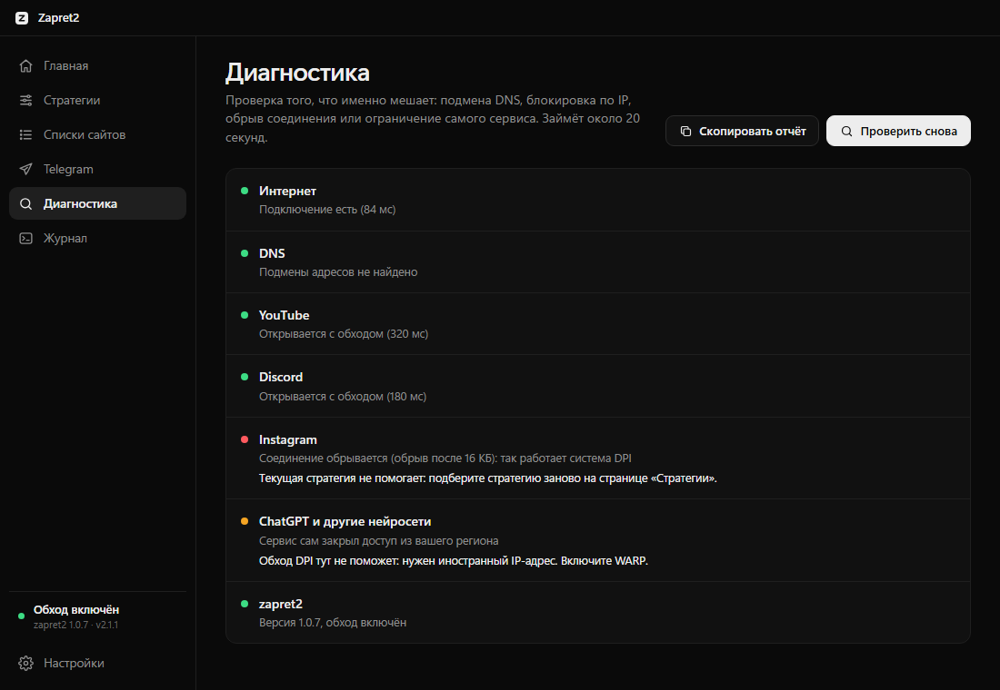
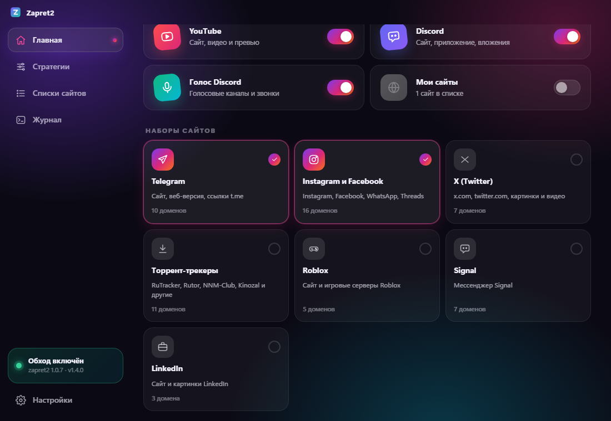
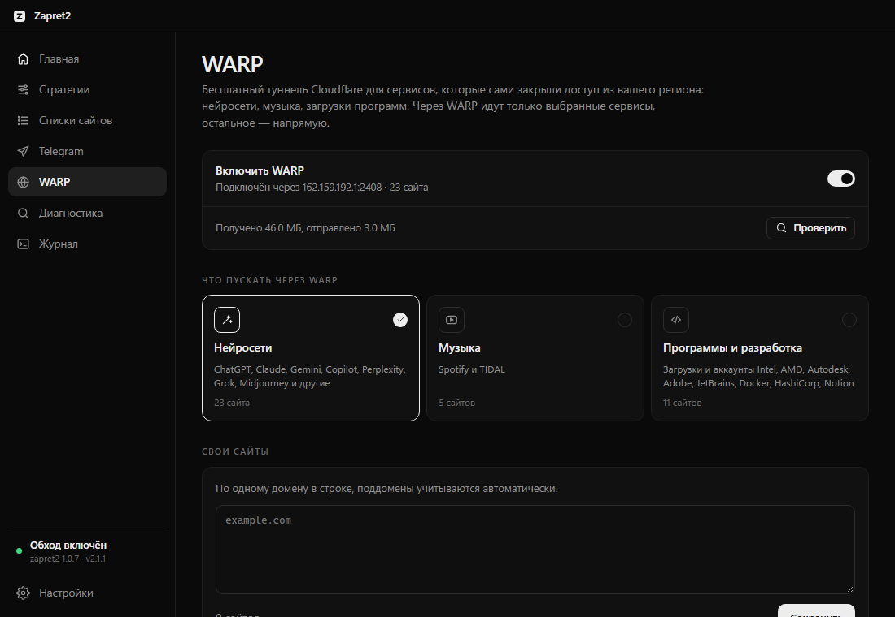
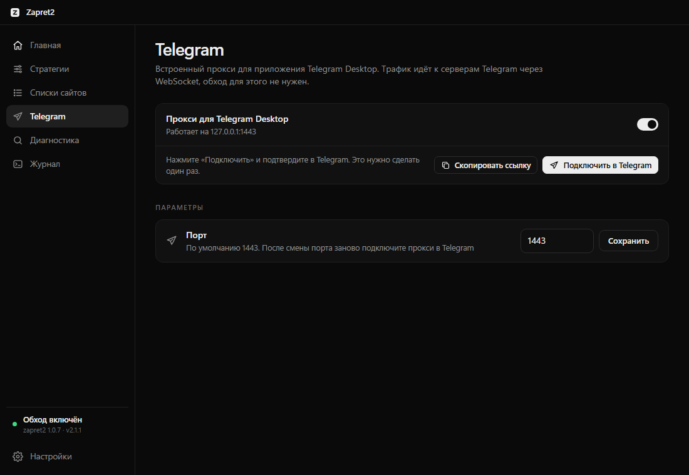
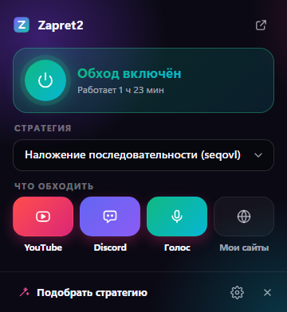
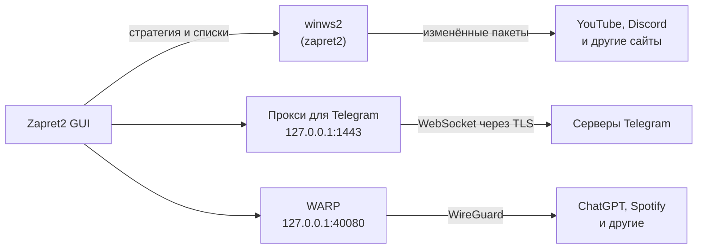

<div align="center">

<picture>
  <source media="(prefers-color-scheme: dark)" srcset="gui/screenshots/logo-dark.svg">
  
</picture>

# Zapret2 GUI

**YouTube, Discord, Telegram, ChatGPT и другие сайты на Windows — одной кнопкой.**<br>
Ставите, отмечаете, что не открывается, — дальше программа всё делает сама.

[](https://github.com/raiyaxkrash/zapret2-rust/releases/latest)

[](https://github.com/raiyaxkrash/zapret2-rust/releases/latest)
[](https://github.com/raiyaxkrash/zapret2-rust/tree/stats)
[](https://github.com/raiyaxkrash/zapret2-rust/actions)


[Возможности](#возможности) · [Установка](#установка) · [Вопросы и ответы](#вопросы-и-ответы) · [English](README.en.md)

<br>

<picture>
  <source media="(prefers-color-scheme: dark)" srcset="gui/screenshots/main-dark.png">
  
</picture>

</div>

<br>

<table>
  <tr>
    <td width="33%" valign="top">
      <h3>Одна кнопка</h3>
      Нажали на сферу — YouTube и Discord открываются. Нажали ещё раз — всё как было. Работает и из мини-окна в трее.
    </td>
    <td width="33%" valign="top">
      <h3>Настраивается сама</h3>
      Мастер спросит, что не открывается, и за минуту подберёт стратегию под вашего провайдера. Если провайдер что-то поменяет, программа заметит и подберёт заново.
    </td>
    <td width="33%" valign="top">
      <h3>Telegram без настроек</h3>
      Встроенный прокси для Telegram Desktop: одна кнопка «Подключить в Telegram», и приложение работает даже там, где не подключается напрямую.
    </td>
  </tr>
</table>

## Возможности

**Что открывает**
- YouTube (включая QUIC), Discord и голосовые каналы Discord, приложение Telegram Desktop.
- Наборы сайтов одной кнопкой: Telegram, Instagram и Facebook, X (Twitter), торрент-трекеры, Roblox, Signal, LinkedIn, **игры и лаунчеры** (Steam, Epic Games, Riot, Ubisoft, EA, GOG, FACEIT), **Twitch**.
- **Зарубежные хостинги и CDN** — для сайтов и игр на Cloudflare, Hetzner, DigitalOcean, OVH, AWS, которые грузятся бесконечно или обрываются.
- Любой свой сайт: вставьте ссылку, и он попадёт в обход.
- **Встроенный WARP** — для сервисов, которые сами закрыли доступ из России: ChatGPT, Claude, Gemini и другие нейросети, Spotify, загрузки Intel, AMD, Adobe, JetBrains. Через бесплатный туннель Cloudflare идут только выбранные сайты, остальное — напрямую. Ставить отдельно ничего не нужно.

**Сама следит и подбирает**
- **Автоподбор стратегии**: каждая стратегия проверяется на настоящих сайтах, для YouTube подбирается отдельная.
- **Сторож**: раз в 15 минут проверяет сервисы и, если провайдер изменил блокировку, сам подбирает новую стратегию.
- **Подсказка для провайдера**: программа определяет провайдера и предлагает стратегию, которая у него уже работала.

**Понятно, что происходит**
- На главной — доступность сервисов («YouTube 320 мс») и график трафика за 10 минут.
- **Диагностика одной кнопкой**: подмена DNS, блокировка по IP, обрыв соединения или ограничение самого сервиса — с советом, что делать.
- **Проверка любого сайта** со всеми стратегиями по очереди.

**Удобно**
- Автообновление программы, стратегий, списков сайтов и самого zapret2.
- Автозапуск с Windows без запроса прав при каждом входе, сворачивание в трей.
- Строгий чёрно-белый дизайн, тёмная и светлая тема, почти не нагружает компьютер.
- Русский и английский интерфейс.
- Windows 11 на ARM64 (Snapdragon).

## Как выглядит

<table>
  <tr>
    <td width="50%"></td>
    <td width="50%"></td>
  </tr>
  <tr>
    <td align="center"><sub><b>Мастер первого запуска</b> — отметьте, что не открывается</sub></td>
    <td align="center"><sub><b>Автоподбор</b> — YouTube и остальные сервисы отдельно</sub></td>
  </tr>
  <tr>
    <td></td>
    <td></td>
  </tr>
  <tr>
    <td align="center"><sub><b>Диагностика</b> — что именно мешает и что делать</sub></td>
    <td align="center"><sub><b>Наборы сайтов</b> — включаются одной кнопкой</sub></td>
  </tr>
  <tr>
    <td></td>
    <td></td>
  </tr>
  <tr>
    <td align="center"><sub><b>WARP</b> — нейросети и сервисы, закрытые для России</sub></td>
    <td align="center"><sub><b>Telegram</b> — подключение одной кнопкой</sub></td>
  </tr>
  <tr>
    <td colspan="2" align="center"><br><sub><b>Мини-окно в трее</b> — всё под рукой</sub></td>
  </tr>
</table>

## Установка

1. **Скачайте** `Zapret2.GUI_X.Y.Z_x64-setup.exe` со [страницы релизов](https://github.com/raiyaxkrash/zapret2-rust/releases/latest).
2. **Запустите** установщик и разрешите права администратора: без них не загрузится сетевой драйвер.
3. **Отметьте** в мастере, что у вас не открывается, и нажмите «Настроить». Всё.

При первом запуске программа сама скачает [zapret2](https://github.com/bol-van/zapret2) с GitHub и проверит его по контрольным суммам.

> [!NOTE]
> **Почему ругается антивирус?** Внутри работает драйвер перехвата пакетов WinDivert — тот же, что в GoodbyeDPI и сборках zapret. Часть антивирусов помечает его как «потенциально нежелательный», хотя это не вирус. [Проверка на VirusTotal](https://www.virustotal.com/gui/file/a7f73e997a1ea0374df15f16ac98f4400e6b81aabc377842ca2f31cc8728e76f): Microsoft Defender, ESET, Dr.Web, BitDefender и Malwarebytes угроз не находят.
>
> Установщик собирается автоматически на GitHub Actions из открытого кода этого репозитория — журнал каждой сборки на вкладке [Actions](https://github.com/raiyaxkrash/zapret2-rust/actions).

## Как это работает



Программа запускает [zapret2](https://github.com/bol-van/zapret2) от bol-van с подобранной стратегией: он слегка изменяет первые пакеты соединения, и система блокировки провайдера перестаёт их узнавать. Сайты при этом открываются напрямую, без VPN и без потери скорости. Для приложения Telegram работает отдельный встроенный прокси. Сервисы, которые сами не пускают из России, идут через встроенный WARP: браузер узнаёт о нём из системных настроек прокси, и через туннель направляются только выбранные сайты.

## Вопросы и ответы

<details>
<summary><b>YouTube не работает, а Discord работает</b></summary>

Серверам Google часто нужна другая стратегия. Откройте «Стратегии» → «Подобрать автоматически» → «Применить»: подбор выставит отдельную стратегию для YouTube. Если не помогло, выключите **QUIC / HTTP3** на странице «Стратегии» и повторите подбор.
</details>

<details>
<summary><b>Что-то не открывается, и непонятно почему</b></summary>

Откройте «Диагностика» → «Проверить». Программа покажет, что именно мешает (подмена DNS, блокировка по IP, обрыв соединения или ограничение самого сервиса), и подскажет, что делать. Отчёт можно скопировать и приложить к issue.
</details>

<details>
<summary><b>Как подключить приложение Telegram?</b></summary>

Включите «Прокси для Telegram» на главной, откройте раздел «Telegram» и нажмите «Подключить в Telegram»: Telegram Desktop сам предложит добавить прокси, это нужно сделать один раз. Прокси работает отдельно от обхода, его можно включить, даже если обход выключен.
</details>

<details>
<summary><b>ChatGPT, Claude или Spotify пишут, что недоступны в вашей стране</b></summary>

Эти сервисы сами закрыли доступ из России, обход блокировок тут не поможет: нужен зарубежный адрес. Откройте раздел «WARP», включите его и отметьте нужные наборы («Нейросети», «Музыка», «Программы и разработка») или впишите свои сайты. Через WARP пойдут только они. Кнопка «Проверить» покажет, через какую страну вы выходите. Если WARP не подключается, проверьте, что включена «Маскировка».
</details>

<details>
<summary><b>Некоторые сайты или игры грузятся бесконечно</b></summary>

Часто это сайты на зарубежных хостингах (Cloudflare, Hetzner, AWS и другие): соединение с ними обрывается после первых килобайт. Включите набор «Зарубежные хостинги и CDN» на странице «Списки сайтов». Для игр есть отдельный набор «Игры и лаунчеры».
</details>

<details>
<summary><b>Чем это отличается от GoodbyeDPI и сборок zapret?</b></summary>

Внутри работает тот же zapret2 от bol-van, но настраивать ничего вручную не нужно: стратегия подбирается автоматически и переподбирается, когда провайдер что-то меняет, списки обновляются сами, есть диагностика и встроенный прокси для Telegram. Одновременно с другими программами обхода приложение работать не может: они используют тот же драйвер. Если они запущены, на главной появится предупреждение с кнопкой «Завершить».
</details>

<details>
<summary><b>Зачем нужны права администратора?</b></summary>

zapret2 перехватывает сетевые пакеты через драйвер WinDivert, а загружать драйверы в Windows может только администратор. Автозапуск сделан через Планировщик заданий, поэтому запрос UAC при каждом входе не появляется.
</details>

<details>
<summary><b>Windows 11 на ARM64 (Snapdragon)</b></summary>

Подписанного драйвера WinDivert для ARM64 не существует. Приложение само подкладывает неподписанный ARM64-драйвер из набора автора zapret, но Windows загрузит его только в **режиме тестовой подписи**: выключите Secure Boot в настройках UEFI, нажмите «Включить тестовый режим» на главном экране и перезагрузите компьютер. Отключить режим можно командой `bcdedit /set {current} testsigning off`.
</details>

<details>
<summary><b>Где хранятся настройки и как удалить?</b></summary>

Настройки и списки лежат в `%LOCALAPPDATA%\Zapret2GUI` (Настройки → «Папка с данными»). Удаляется программа через «Параметры Windows» → «Приложения», вместе с заданием автозапуска.
</details>

Не нашли ответа? [Создайте issue](https://github.com/raiyaxkrash/zapret2-rust/issues/new/choose) и приложите отчёт диагностики.

## Помочь проекту

- **Поделитесь стратегией.** После подбора нажмите «Поделиться результатом»: из таких отчётов собираются подсказки для каждого провайдера.
- **Предложите сайт** для встроенных наборов — [форма](https://github.com/raiyaxkrash/zapret2-rust/issues/new?template=site.yml).
- **Поставьте звезду** ⭐ — так проект проще найти.

<details>
<summary><b>Для разработчиков</b></summary>

| Путь | Что там |
| --- | --- |
| [`gui/`](gui/) | Приложение: Rust (Tauri 2) и интерфейс на HTML/CSS. Сборка, стратегии и выпуск версий — в [gui/README.md](gui/README.md) |
| [`gui/resources/presets.json`](gui/resources/presets.json) | Стратегии и наборы сайтов. Изменения доходят до установленных копий без нового релиза |
| [`gui/resources/lists/`](gui/resources/lists/) | Встроенные списки доменов и подсетей |
| [`gui/scripts/`](gui/scripts/) | Выпуск версий и обновление списка подсетей хостингов |
| [`.github/workflows/release.yml`](.github/workflows/release.yml) | Тесты, сборка и публикация подписанных релизов по тегу `vX.Y.Z` |
| [`.github/workflows/stats.yml`](.github/workflows/stats.yml) | Ежедневная статистика по счётчикам скачиваний GitHub (без телеметрии) — ветка [`stats`](https://github.com/raiyaxkrash/zapret2-rust/tree/stats) |

Сборка: нужны Rust (MSVC), Visual Studio Build Tools (C++) и Node.js.

```bash
cd gui
npm install
npm run build
```

zapret2 в репозиторий и установщик не входит: приложение скачивает его из [релизов bol-van/zapret2](https://github.com/bol-van/zapret2/releases). Параметры winws2 описаны в [manual.md](https://github.com/bol-van/zapret2/blob/master/docs/manual.md).
</details>

## Благодарности

- [**zapret2**](https://github.com/bol-van/zapret2) и [zapret-win-bundle](https://github.com/bol-van/zapret-win-bundle) от **bol-van** — движок обхода и ARM64-драйвер (MIT).
- [**tg-ws-proxy**](https://github.com/Flowseal/tg-ws-proxy) от **Flowseal** — протокол, на котором основан прокси для Telegram (MIT).
- [WinDivert](https://reqrypt.org/windivert.html) — драйвер перехвата пакетов. [Tauri](https://tauri.app) — основа приложения.

<div align="center">
<br>
<sub>Сделано для тех, кому просто нужно, чтобы всё открывалось.</sub>
</div>
