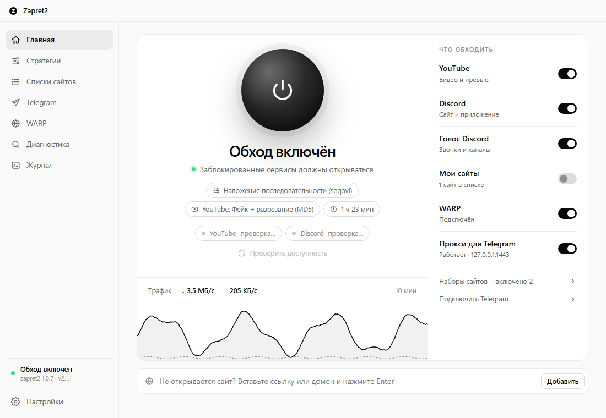
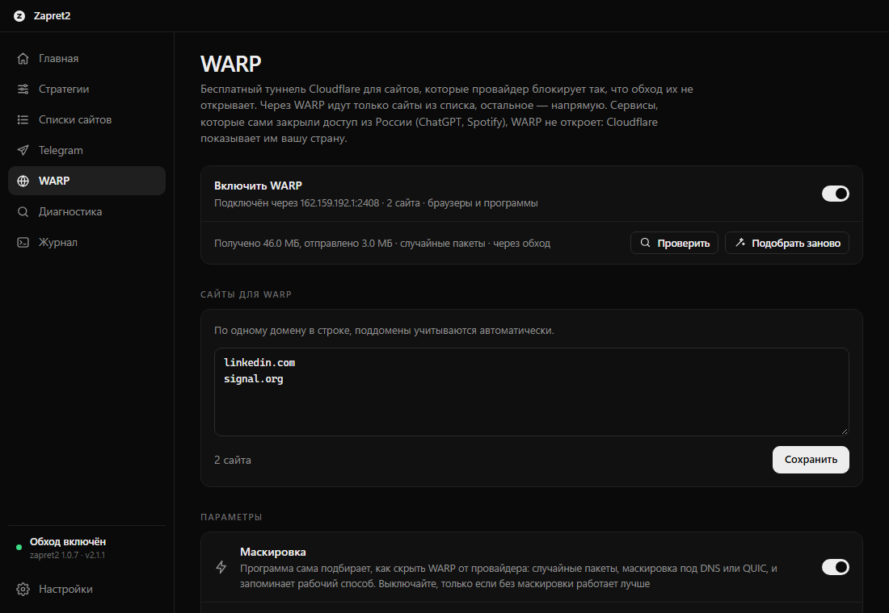
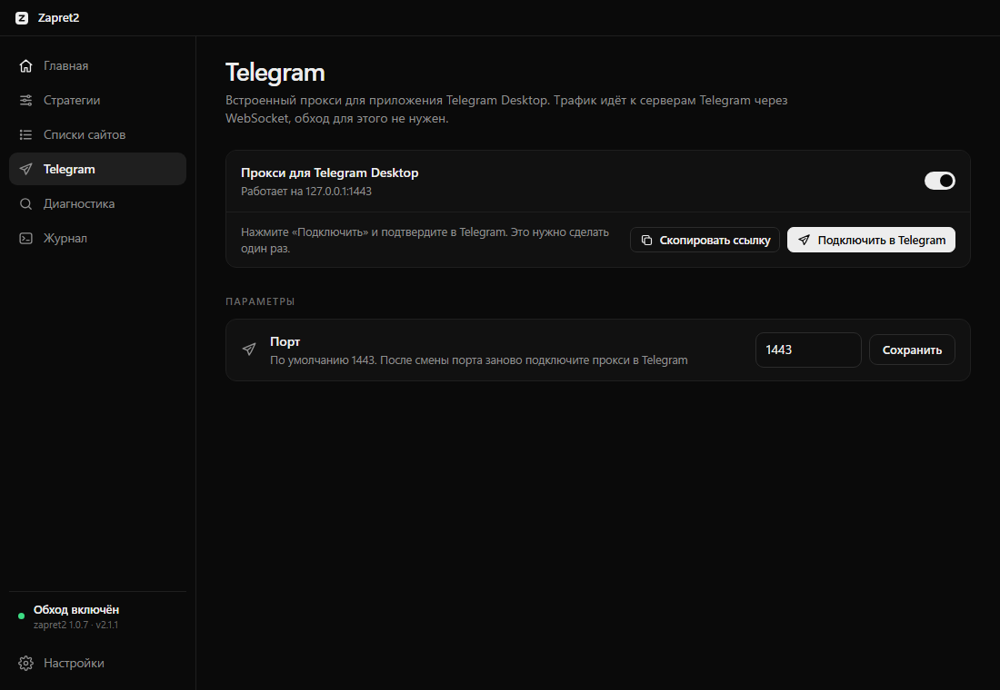
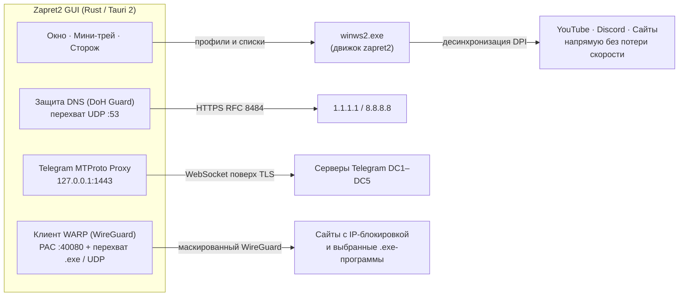

<div align="center">

<picture>
  <source media="(prefers-color-scheme: dark)" srcset="gui/screenshots/banner-dark.svg">
  
</picture>

<br><br>

[](https://github.com/raiyaxkrash/zapret2-rust/releases/latest)

[](https://github.com/raiyaxkrash/zapret2-rust/releases/latest)
[](https://github.com/raiyaxkrash/zapret2-rust/tree/stats)
[](https://github.com/raiyaxkrash/zapret2-rust/actions)
[](gui/)
[](https://github.com/raiyaxkrash/zapret2-rust/stargazers)
[](https://t.me/raygit)

**[Возможности](#что-умеет)** · **[Интерфейс](#как-выглядит)** · **[Сравнение](#чем-отличается)** · **[Архитектура](#как-это-работает)** · **[Установка](#установка)** · **[Управление](#быстрое-управление)** · **[Вопросы](#вопросы-и-ответы)** · **[English](README.en.md)**

<br>

<picture>
  <source media="(prefers-color-scheme: dark)" srcset="gui/screenshots/main-dark.png">
  
</picture>

<sub>Современная нативная оболочка на Rust для <b>zapret2</b> со встроенным туннелем Cloudflare WARP, прокси для Telegram Desktop, защитой DNS и автоматическим подбором стратегий.</sub>

</div>

<br>

## Что умеет

<table>
  <tr>
    <td width="33%" valign="top">
      <br>
      <h3>Одна кнопка и горячая клавиша</h3>
      Нажали на сферу, кликнули средней кнопкой по значку в трее или нажали <code>Ctrl+Shift+Z</code> поверх игры — YouTube, Discord и нужные сайты работают без потери скорости.
    </td>
    <td width="33%" valign="top">
      <br>
      <h3>Умный автоподбор</h3>
      Проверяет 10 стратегий на настоящих сайтах и узлах видеопотока YouTube (GGC), подбирает отдельную стратегию для Google и сам проверяет, нужно ли выключить QUIC.
    </td>
    <td width="33%" valign="top">
      <br>
      <h3>Сторож и память сетей</h3>
      Раз в 15 минут проверяет доступность и переподбирает стратегию, если провайдер изменил DPI. Запоминает рабочую связку отдельно для домашнего Wi-Fi и мобильного модема.
    </td>
  </tr>
  <tr>
    <td width="33%" valign="top">
      <br>
      <h3>Туннель WARP для сайтов и .exe</h3>
      Встроенный WireGuard-клиент Cloudflare с автомаскировкой от DPI. Пропускает только выбранные сайты или целые программы (<code>.exe</code>), включая голосовой и игровой UDP-трафик.
    </td>
    <td width="33%" valign="top">
      <br>
      <h3>Telegram без настроек</h3>
      Нативный локальный MTProto-прокси поверх WebSocket/TLS с автоматическим резервированием через Cloudflare. Подключается в Telegram Desktop одной кнопкой.
    </td>
    <td width="33%" valign="top">
      <br>
      <h3>Диагностика и защита DNS</h3>
      За 10 секунд определяет причину проблемы (подмена DNS, блок по IP, обрыв по DPI на 16 КБ или геоблок) и одной кнопкой включает встроенное шифрование DNS-over-HTTPS.
    </td>
  </tr>
</table>

<details>
<summary><b>Всё, что внутри — полный список возможностей</b></summary>

<br>

**Обход DPI (`winws2`)**
- Готовые профили для **YouTube** (TCP + QUIC), **Discord**, **голосовых каналов Discord** (`STUN` / `IP Discovery`) и списка **«Мои сайты»**.
- **10 выверенных стратегий** (включая мутацию TLS `rnd,dupsid`, `syndata`, `seqovl`, `autottl`, `badseq`, `tcp_md5`, `tcp_ts`) + режим ручных аргументов `--lua-desync`.
- **10 наборов сайтов одной кнопкой:** Telegram, Instagram и Facebook, X (Twitter), торрент-трекеры, Roblox, Signal, LinkedIn, Twitch, игры и лаунчеры (Steam, Epic Games, Riot, Ubisoft, EA, GOG, FACEIT), а также ~16 300 подсетей зарубежных хостингов и CDN (Cloudflare, Hetzner, DigitalOcean, OVH, AWS).
- **Три режима «Моих сайтов»:** только ваш список, список + автодобавление недоступных доменов (`autohostlist`), либо все сайты кроме исключений.
- Полная поддержка кириллических доменов (`.рф`, `.рус`) — автоматическое преобразование в Punycode при вводе ссылки или домена.
- Строгая блокировка QUIC (`--lua-desync=drop`) для YouTube, Discord и пользовательских списков при отключении переключателя QUIC.

**Встроенный Cloudflare WARP (раздельное туннелирование)**
- Собственная реализация WireGuard в пространстве пользователя (`boringtun` + `smoltcp`) — без установки сторонних сетевых адаптеров и служб.
- **Автоматическая маскировка рукопожатия** от ТСПУ: случайные шумовые пакеты, маскировка под DNS или QUIC, маршрут через активный обход `winws2`.
- **Точечная маршрутизация:** браузеры направляются через автогенерируемый PAC-скрипт только для выбранных доменов, а выбранные `.exe`-приложения (с выбором из списка запущенных процессов) перехватываются через WinDivert на уровне сокетов вместе с голосовым и игровым UDP.
- Поддержка лицензионных ключей **WARP+** и перевыпуска аккаунта в один клик.

**Защита DNS и диагностика**
- **Встроенный перехватчик DNS (DoH Guard):** прозрачно шифрует системные запросы `UDP:53` через `1.1.1.1` и `8.8.8.8` (RFC 8484) с локальным TTL-кэшем без изменения настроек сетевой карты Windows.
- **Интерактивная диагностика:** параллельно проверяет интернет, отравление DNS, обрывы после 16 КБ (DPI), блокировку по IP и региональные ограничения с кнопками мгновенного исправления прямо в отчёте.
- Если сайт заблокирован по IP и ни одна стратегия DPI его не открывает, проверка сайта сразу предлагает кнопку **«Пустить через WARP»**.

**Нативность, производительность и портативность**
- Строгий монохромный интерфейс без `backdrop-filter: blur` и фоновых GPU-анимаций: **0% нагрузки на видеокарту** при свёрнутом в трей окне.
- Прямая работа с реестром и списком процессов через Win32 API (`CreateToolhelp32Snapshot`, `RegGetValueW`) без порождения скрытых консольных процессов.
- **Мини-окно в трее** с 6 плитками сервисов (YouTube, Discord, Голос, Мои сайты, WARP, Telegram), выбором стратегии и запуском подбора.
- **Резервное копирование** настроек и списков в один JSON-файл и **портативный режим** (достаточно создать файл `portable` рядом с `.exe`).
- Три независимых канала автообновления: само приложение (с проверкой криптографической подписи), движок `zapret2` (с проверкой SHA-256) и облачные пресеты/списки с GitHub.
- Поддержка Windows 10 / 11 (x64 и ARM64 Snapdragon).
</details>

## Как выглядит

<table>
  <tr>
    <td width="50%"></td>
    <td width="50%"></td>
  </tr>
  <tr>
    <td align="center"><sub><b>Мастер первого запуска</b><br>отметьте нужное — стратегия подберётся сама</sub></td>
    <td align="center"><sub><b>Автоподбор стратегий</b><br>раздельная оценка YouTube, GGC и остальных сайтов</sub></td>
  </tr>
  <tr>
    <td></td>
    <td></td>
  </tr>
  <tr>
    <td align="center"><sub><b>Cloudflare WARP</b><br>выборочный туннель для сайтов и .exe-программ</sub></td>
    <td align="center"><sub><b>Интерактивная диагностика</b><br>точная причина блокировки и кнопка решения</sub></td>
  </tr>
  <tr>
    <td></td>
    <td></td>
  </tr>
  <tr>
    <td align="center"><sub><b>Наборы сайтов и состав</b><br>включение одной кнопкой и просмотр доменов</sub></td>
    <td align="center"><sub><b>Прокси для Telegram Desktop</b><br>локальный WebSocket-туннель без сторонних утилит</sub></td>
  </tr>
</table>

## Чем отличается

В основе обхода лежит оригинальный [zapret2](https://github.com/bol-van/zapret2) от **bol-van**, дополненный собственными сетевыми модулями на Rust. Главное отличие — полная автоматизация и работа всех инструментов в одном лёгком приложении:

| Возможность | **Zapret2 GUI** | zapret-discord-youtube | GoodbyeDPI |
| :-- | :-: | :-: | :-: |
| Управление | Нативное окно, мини-трей, `Ctrl+Shift+Z` | `.bat`-файлы в консоли | `.cmd`-файлы в консоли |
| Автоподбор стратегии | ✓ раздельно для YouTube + тест QUIC | Ручной выбор `.bat` после теста | Подбор флагов вручную |
| Автовосстановление при смене блокировки | ✓ фоновый сторож с откатом | — | — |
| Своя стратегия для каждой сети (Wi-Fi / модем) | ✓ автопереключение + история | — | — |
| Встроенный туннель Cloudflare WARP | ✓ домены + `.exe`-программы + UDP | — | — |
| Встроенный прокси для Telegram Desktop | ✓ локальный MTProto-WS | — | — |
| Встроенная защита от подмены DNS | ✓ прозрачный DoH (`1.1.1.1` / `8.8.8.8`) | — | — |
| Диагностика причин недоступности | ✓ DNS / DPI 16 КБ / IP-блок / геоблок | Только проверка конфликтов | — |
| Портативный режим и бэкап настроек | ✓ в один клик | Папка со скриптами | Папка со скриптами |
| Автообновление движка, списков и стратегий | ✓ с проверкой SHA-256 и подписи | Ручное скачивание архива | Ручное скачивание |

<sub>Уже установлена сборка на `.bat`-файлах или GoodbyeDPI? Zapret2 GUI аккуратно обнаружит её, позволит пользоваться WARP и Telegram параллельно, а при включении обхода предложит перенести ваши списки сайтов и временно перевести старую службу в ручной режим (с возможностью вернуть обратно в один клик).</sub>

## Как это работает

Приложение объединяет **четыре независимых сетевых контура**, которые можно включать вместе или по отдельности:



1. **Десинхронизация DPI (`winws2`).** Модифицирует только первые пакеты установки соединения (разрезание SNI, фейковые пакеты с авто-TTL/MD5/timestamp, наложение сегментов `seqovl`). Весь дальнейший поток видео, игр и файлов идёт **напрямую на полной скорости вашего тарифа**.
2. **Защита DNS (`DoH Guard`).** Если провайдер перехватывает обычные DNS-запросы и возвращает фальшивые IP-адреса, встроенный фильтр прозрачно заворачивает запросы по порту `53` в зашифрованный HTTPS-канал к `1.1.1.1` и `8.8.8.8`.
3. **Точечный туннель (`WARP`).** Если ресурс заблокирован по IP-адресу (где бессилен любой обход DPI), трафик только этого сайта или выбранного `.exe`-приложения уходит в зашифрованный туннель Cloudflare WireGuard с автоматическим обходом блокировки самого WARP.
4. **Прокси для Telegram.** Упаковывает протокол MTProto в стандартные WebSocket-соединения поверх TLS (`wss://kws*.web.telegram.org/apiws`) с автоматическим переключением на резервный маршрут при сбоях.

## Установка

<table>
  <tr>
    <td width="33%" valign="top">
      <h3>1 · Скачайте</h3>
      Загрузите <code>Zapret2.GUI_X.Y.Z_x64-setup.exe</code> со <a href="https://github.com/raiyaxkrash/zapret2-rust/releases/latest">страницы последнего релиза</a>.
    </td>
    <td width="33%" valign="top">
      <h3>2 · Запустите</h3>
      Подтвердите запрос прав администратора — они необходимы Windows для загрузки сетевого драйвера WinDivert.
    </td>
    <td width="33%" valign="top">
      <h3>3 · Отметьте сервисы</h3>
      В мастере первого запуска выберите, что не открывается, и нажмите <b>«Настроить»</b>. Через минуту всё готово.
    </td>
  </tr>
</table>

При первом включении приложение автоматически скачает актуальный выпуск [zapret2](https://github.com/bol-van/zapret2) с GitHub и сверит контрольные суммы SHA-256 каждого файла.

> [!TIP]
> **Портативный режим (на флешке или в отдельной папке):** создайте пустой файл `portable` или `portable.txt` рядом с `zapret2-gui.exe`. Все настройки, списки, ключи WARP и скачанный движок будут храниться в подпапке `data\` рядом с программой, не оставляя следов в `%LOCALAPPDATA%`.

> [!NOTE]
> **Реакция антивирусов на WinDivert.** Сетевой драйвер перехвата пакетов `WinDivert64.sys` официально подписан цифровой подписью для ядра Windows (тот же драйвер используется в GoodbyeDPI, Wireshark-инструментах и сборках zapret). Отдельные антивирусы помечают любые перехватчики пакетов как `RiskTool` / `PUA`. [Отчёт VirusTotal](https://www.virustotal.com/gui/file/a7f73e997a1ea0374df15f16ac98f4400e6b81aabc377842ca2f31cc8728e76f): Microsoft Defender, Kaspersky/Dr.Web, ESET, BitDefender и Malwarebytes подтверждают чистоту файла. Все релизы собираются прозрачно в [GitHub Actions](https://github.com/raiyaxkrash/zapret2-rust/actions).

## Быстрое управление

| Действие | Как выполнить |
| :--- | :--- |
| Включить / выключить обход поверх любого окна | Глобальная комбинация **`Ctrl + Shift + Z`** *(отключается в Настройках)* |
| Открыть мини-окно с плитками сервисов | **Левый клик** по значку Zapret2 в системном трее |
| Мгновенно переключить обход из трея | **Средний клик (колёсиком)** по значку в трее |
| Открыть главное окно из трея | **Двойной клик** по значку в трее |
| Сохранить открытый список или параметры | **`Ctrl + S`** на страницах «Списки сайтов», «WARP» и «Стратегии» |
| Найти строку в журнале событий | **`Ctrl + F`** на странице «Журнал» |

## Вопросы и ответы

<details>
<summary><b>YouTube открывается, но само видео бесконечно крутит загрузку</b></summary>

Потоковое видео раздаётся с региональных кэш-серверов Google (`*.googlevideo.com`), которые часто режутся по протоколу QUIC (UDP 443) строже, чем сам сайт `youtube.com`. Запустите **«Подобрать автоматически»** на вкладке «Стратегии» (или через «Мастер настройки»): приложение проверит редиректор видеопотока и при необходимости само предложит отключить **QUIC / HTTP3**, выставив отдельную стратегию для YouTube.
</details>

<details>
<summary><b>Сайт заблокирован по IP — ни одна стратегия DPI его не открывает</b></summary>

Вставьте ссылку в поле **«Проверить сайт»** на вкладке «Стратегии». Если сайт не открывается ни с одной стратегией, появится кнопка **«Пустить через WARP»** — домен автоматически добавится в список Cloudflare WARP и заработает через туннель, не затрагивая скорость остальных сайтов.
</details>

<details>
<summary><b>Как пустить через WARP отдельную игру или программу целиком?</b></summary>

Откройте вкладку **WARP** → раздел **«Программы для WARP»**. Выберите нужное приложение из выпадающего списка **«Из запущенных…»** (или впишите имя файла, например `discord.exe`). Весь TCP и игровой/голосовой UDP-трафик этого процесса пойдёт через туннель WARP независимо от списка доменов.
</details>

<details>
<summary><b>Провайдер подменяет DNS — нужно ли менять настройки сети Windows вручную?</b></summary>

Нет. Достаточно включить **«Защита DNS (DNS-over-HTTPS)»** в разделе «Настройки → Дополнительно» (или нажать кнопку **«Включить защиту DNS»** прямо в отчёте диагностики). Zapret2 GUI сам перехватит и зашифрует DNS-запросы всех программ.
</details>

<details>
<summary><b>ChatGPT, Claude или Spotify пишут, что сервис недоступен в вашем регионе</b></summary>

Эти площадки сами ограничивают российские аккаунты и проверяют геолокацию по выходящему адресу. Обычный обход DPI оставляет ваш реальный IP, а бесплатный Cloudflare WARP по правилам сети Cloudflare передаёт партнёрам код вашей настоящей страны. Для таких сервисов требуется зарубежный прокси или VPN.
</details>

<details>
<summary><b>Поддерживаются ли кириллические домены (.рф, .рус)?</b></summary>

Да. Вставляйте ссылку или домен как есть (например, `https://пример.рф/page`) — приложение автоматически очистит URL и преобразует домен в стандартный формат Punycode (`xn--...`).
</details>

<details>
<summary><b>Где находятся стратегии, журнал и командная строка winws2?</b></summary>

По умолчанию включён лаконичный режим, чтобы не перегружать интерфейс. Включите **«Настройки → Оформление → Режим для опытных»**, и в боковом меню появятся разделы «Стратегии», «Журнал», тонкие настройки портов, ключей WARP+ и режимов списков.
</details>

<details>
<summary><b>Как работает на ноутбуках с процессором ARM64 (Snapdragon)?</b></summary>

Приложение автоматически определяет архитектуру ARM64 и подставляет совместимый `WinDivert64.sys` из набора автора zapret. Так как подписанного Microsoft драйвера WinDivert под ARM64 не существует, потребуется отключить Secure Boot в UEFI и нажать кнопку **«Включить тестовый режим»** прямо на главном экране программы.
</details>

<details>
<summary><b>Где хранятся данные и как перенести настройки на другой ПК?</b></summary>

По умолчанию данные хранятся в `%LOCALAPPDATA%\Zapret2GUI`. Чтобы перенести конфигурацию и все свои списки на другой компьютер, нажмите **«Экспорт»** в строке «Резервная копия» (`Настройки → Дополнительно`), а на новом ПК нажмите **«Импорт»**.
</details>

Остались вопросы или нашли баг? [Создайте обращение в Issues](https://github.com/raiyaxkrash/zapret2-rust/issues/new/choose) с приложенным отчётом диагностики или загляните в Telegram-канал [@raygit](https://t.me/raygit).

## Помочь проекту

<table>
  <tr>
    <td width="33%" valign="top">
      <h3>Поделитесь стратегией</h3>
      После успешного автоподбора нажмите <b>«Поделиться результатом»</b> — так формируется база стартовых рекомендаций по ASN провайдеров.
    </td>
    <td width="33%" valign="top">
      <h3>Предложите домен</h3>
      Заметили, что в готовом наборе не хватает нового CDN-домена сервиса? Отправьте <a href="https://github.com/raiyaxkrash/zapret2-rust/issues/new?template=site.yml">короткую заявку</a>.
    </td>
    <td width="33%" valign="top">
      <h3>Поставьте звезду ⭐</h3>
      Звезда на GitHub помогает проекту оставаться заметным для всех, кто ищет чистый и безопасный способ вернуть доступ к сети.
    </td>
  </tr>
</table>

<details>
<summary><b>Для разработчиков и контрибьюторов</b></summary>

<br>

Подробное описание внутренней архитектуры модулей Rust, формата `presets.json`, сборки и выпуска релизов находится в [**`gui/README.md`**](gui/README.md).

| Путь | Назначение |
| :--- | :--- |
| [`gui/src-tauri/src/`](gui/src-tauri/src/) | Бэкенд на Rust: управление `winws2`, `dns_guard`, стек WireGuard `warp`, `tgproxy`, автоподбор, диагностика, WinAPI-утилиты |
| [`gui/ui/`](gui/ui/) | Фронтенд без тяжёлых фреймворков (чистый ES2022 + CSS Variables), мини-окно трея и реактивный словарь локализации `i18n.js` |
| [`gui/resources/presets.json`](gui/resources/presets.json) | Облачный реестр стратегий, наборов сайтов и подсказок по ASN провайдеров |
| [`gui/resources/lists/`](gui/resources/lists/) | Встроенные списки доменов и CIDR-подсетей зарубежных хостингов |
| [`gui/scripts/`](gui/scripts/) | Проверка полноты переводов (`check-i18n.mjs`), обновление подсетей RIPEstat и скрипт релиза |
| [`.github/workflows/release.yml`](.github/workflows/release.yml) | CI-конвейер: `cargo clippy -D warnings`, модульные тесты, проверка переводов, сборка и подпись релиза |

Быстрый старт сборки (требуются Rust stable MSVC, Visual Studio C++ Build Tools и Node.js 20+):

```powershell
cd gui
npm install
node scripts/check-i18n.mjs
cd src-tauri && cargo test --lib && cd ..
npm run build
```
</details>

## Благодарности

- [**zapret2**](https://github.com/bol-van/zapret2) и [zapret-win-bundle](https://github.com/bol-van/zapret-win-bundle) от **bol-van** — движок обхода DPI `winws2`, Lua-библиотеки десинхронизации и сборка драйверов (MIT).
- [**tg-ws-proxy**](https://github.com/Flowseal/tg-ws-proxy) от **Flowseal** — идея и спецификация обфускации MTProto поверх WebSocket (MIT).
- [WinDivert](https://reqrypt.org/windivert.html) — перехват сетевых пакетов в ядре Windows · [Tauri 2](https://tauri.app) — лёгкая платформа приложения · [Cloudflare WARP](https://one.one.one.one/) — сеть WireGuard.

<br>

<div align="center">
<br>
<sub>Сделано с вниманием к деталям для тех, кому просто нужно, чтобы всё открывалось.</sub>
</div>
