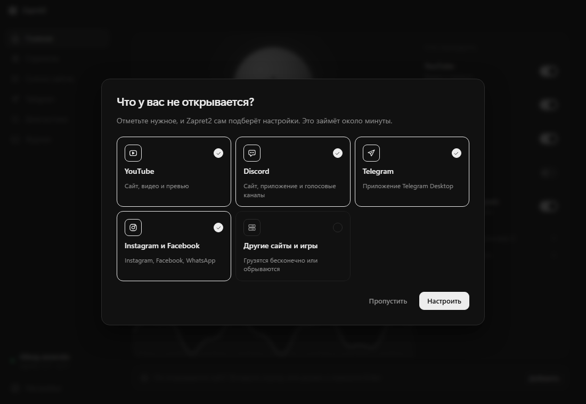
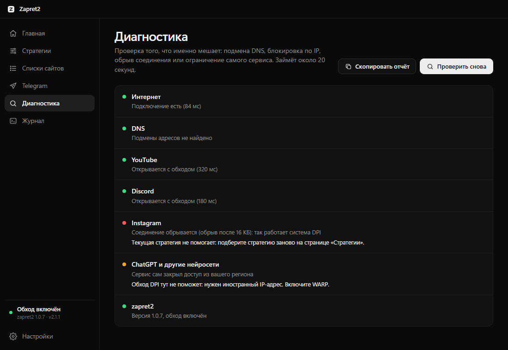
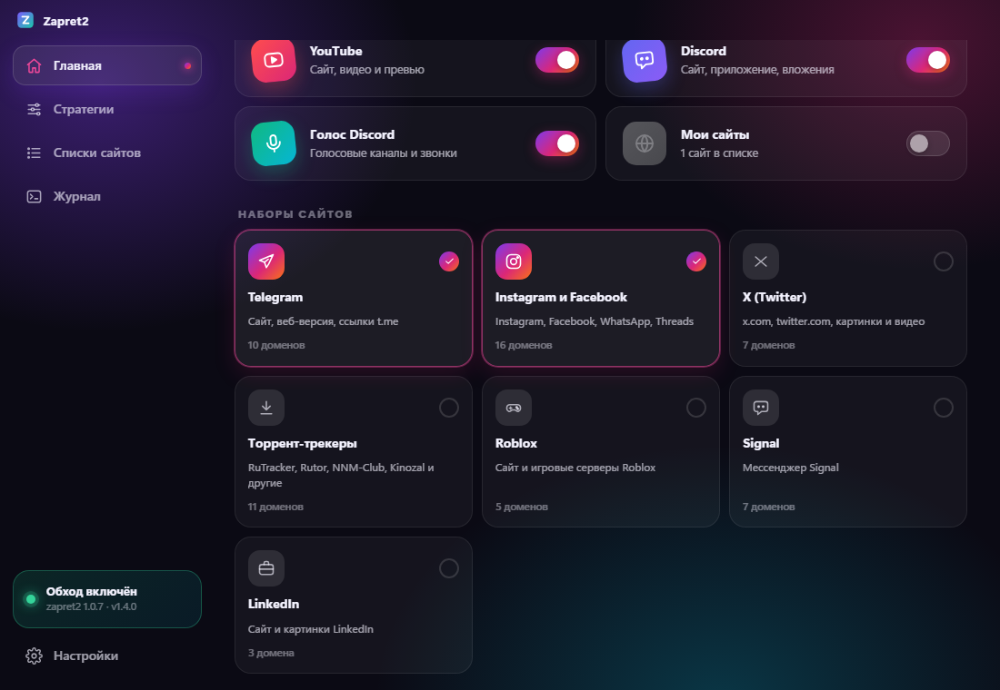
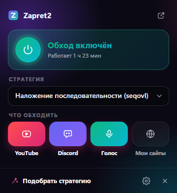
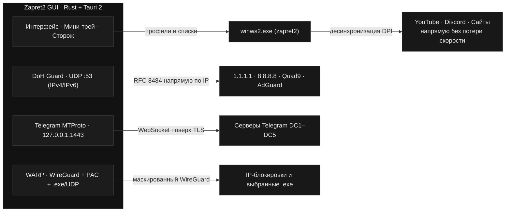

<div align="center">

<picture>
  <source media="(prefers-color-scheme: dark)" srcset="gui/screenshots/banner-dark.svg">
  
</picture>

<br><br>

<p>
  <a href="https://github.com/raiyaxkrash/zapret2-rust/releases/latest">
    
  </a>
  &nbsp;
  <a href="https://t.me/raygit">
    
  </a>
</p>

<p>
  <a href="https://github.com/raiyaxkrash/zapret2-rust/releases/latest"></a>
  <a href="https://github.com/raiyaxkrash/zapret2-rust/tree/stats"></a>
  <a href="https://github.com/raiyaxkrash/zapret2-rust/actions"></a>
  <a href="gui/"></a>
  <a href="https://github.com/raiyaxkrash/zapret2-rust/stargazers"></a>
</p>

<br>

<sub>
  <a href="#возможности"><b>Возможности</b></a> &nbsp;·&nbsp;
  <a href="#интерфейс"><b>Интерфейс</b></a> &nbsp;·&nbsp;
  <a href="#архитектура"><b>Архитектура</b></a> &nbsp;·&nbsp;
  <a href="#сравнение"><b>Сравнение</b></a> &nbsp;·&nbsp;
  <a href="#быстрый-старт"><b>Установка</b></a> &nbsp;·&nbsp;
  <a href="#управление"><b>Управление</b></a> &nbsp;·&nbsp;
  <a href="#частые-вопросы"><b>FAQ</b></a> &nbsp;·&nbsp;
  <a href="README.en.md"><b>English</b></a>
</sub>

<br><br>

<picture>
  <source media="(prefers-color-scheme: dark)" srcset="gui/screenshots/main-dark.png">
  
</picture>

<br><br>

<table>
  <tr>
    <td align="center" width="25%"><b>0% GPU</b><br><sub>в свёрнутом режиме</sub></td>
    <td align="center" width="25%"><b>4 контура</b><br><sub>DPI · WARP · DoH · Telegram</sub></td>
    <td align="center" width="25%"><b>10 стратегий</b><br><sub>+ свои именованные пресеты</sub></td>
    <td align="center" width="25%"><b>x64 & ARM64</b><br><sub>Windows 10 / 11 + Portable</sub></td>
  </tr>
</table>

<sub>Нативная оболочка на <b>Rust</b> для <b>zapret2</b>: обход DPI без потери скорости, встроенный туннель Cloudflare WARP, прокси для Telegram Desktop, защита DNS (IPv4 + IPv6) и умный автоподбор стратегий.</sub>

</div>

<br>

---

## Возможности

<table>
  <tr>
    <td width="33%" valign="top">
      <br>
      <h4>Одна кнопка и хоткей</h4>
      Нажмите на сферу, кликните колёсиком по трею или нажмите <code>Ctrl+Shift+Z</code> поверх игры — сервисы работают на полной скорости тарифа.
    </td>
    <td width="33%" valign="top">
      <br>
      <h4>Умный автоподбор</h4>
      Тестирует 10 стратегий на реальных сайтах и GGC-узлах YouTube, ловит обрывы на 16 КБ и зондирует <b>QUIC (UDP 443)</b> напрямую.
    </td>
    <td width="33%" valign="top">
      <br>
      <h4>Сторож и память сетей</h4>
      Раз в 15 минут проверяет доступность и переподбирает стратегию при смене DPI. Хранит отдельные профили для домашнего Wi-Fi и модема.
    </td>
  </tr>
  <tr>
    <td width="33%" valign="top">
      <br>
      <h4>WARP для сайтов и .exe</h4>
      Собственный userspace WireGuard (<code>boringtun</code> + <code>smoltcp</code>) с маскировкой от ТСПУ. Пропускает только нужные домены или целые <code>.exe</code> с UDP.
    </td>
    <td width="33%" valign="top">
      <br>
      <h4>Telegram без настроек</h4>
      Встроенный локальный MTProto-прокси поверх WebSocket/TLS с резервированием через Cloudflare. Подключается в Telegram Desktop в один клик.
    </td>
    <td width="33%" valign="top">
      <br>
      <h4>Диагностика и DoH Guard</h4>
      За 10 секунд находит причину (DNS, DPI 16 КБ, IP-блок, геоблок) и включает прозрачный <b>DNS-over-HTTPS</b> (IPv4 + IPv6, выбор сервера).
    </td>
  </tr>
</table>

<details>
<summary><b>Подробный список возможностей под капотом</b></summary>

<br>

**Обход DPI (`winws2`)**
- Отдельные профили для **YouTube** (TCP + QUIC), **Discord**, **голосовых каналов Discord** (`STUN` / `IP Discovery`) и **«Моих сайтов»**.
- **10 стратегий** (`rnd,dupsid`, `syndata`, `seqovl`, `autottl`, `badseq`, `tcp_md5`, `tcp_ts`) + **именованные пользовательские пресеты** `--lua-desync`.
- **10 наборов сайтов одной кнопкой:** Telegram, Instagram/Facebook, X (Twitter), торрент-трекеры, Roblox, Signal, LinkedIn, Twitch, игры/лаунчеры (Steam, Epic, Riot, Ubisoft, EA, GOG, FACEIT) и ~16 300 подсетей зарубежных хостингов (Cloudflare, Hetzner, DigitalOcean, OVH, AWS).
- **Три режима «Моих сайтов»:** только свой список, автодобавление (`autohostlist`) или все сайты кроме исключений. Автоконвертация кириллических доменов (`.рф`, `.рус`) в Punycode.
- Строгая блокировка QUIC (`--lua-desync=drop`) при отключении переключателя QUIC.

**Встроенный Cloudflare WARP (Split Tunnel)**
- Чистый Rust-стек `boringtun` + `smoltcp` — без виртуальных TUN-адаптеров и фоновых служб Windows.
- **Автомаскировка рукопожатия:** шумовые пакеты, мимикрия под DNS/QUIC, проброс через активный `winws2`.
- **Точечная маршрутизация:** автогенерируемый PAC-скрипт для браузеров + WinDivert-перехват выбранных `.exe` (TCP и игровой/голосовой UDP).
- Поддержка ключей **WARP+** и перевыпуск WireGuard-аккаунта в один клик.

**Защита DNS (DoH Guard) и диагностика**
- Прозрачный перехват `UDP:53` (**IPv4 и IPv6**) → RFC 8484 DoH напрямую по IP (`1.1.1.1`, `8.8.8.8`, Quad9 `9.9.9.9`, AdGuard `94.140.14.14` или свой HTTPS-адрес) с **TTL-кэшем** (с учётом `RCODE`), singleflight-дедупликацией и счётчиками в интерфейсе.
- Параллельная диагностика с кнопками мгновенного решения прямо в отчёте и перенаправлением IP-заблокированных доменов в WARP.

**Нативность, безопасность и портативность**
- Строгий монохром без `backdrop-filter: blur` и фоновых GPU-анимаций (**0% GPU** в трее).
- Прямые вызовы Win32 API (`CreateToolhelp32Snapshot`, `RegGetValueW`, `IdnToAscii`, `RegisterHotKey`) без мигания консолей.
- **Экспорт/импорт** всех настроек и списков в JSON и **портативный режим** (пустой файл `portable` рядом с `.exe`).
- Три канала автообновления: приложение (с криптоподписью), `zapret2` (проверка SHA-256) и облачные пресеты с GitHub.
</details>

<br>

---

## Интерфейс

<table>
  <tr>
    <td width="50%"></td>
    <td width="50%"></td>
  </tr>
  <tr>
    <td align="center"><sub><b>Мастер первого запуска</b><br>отметьте сервисы — стратегия подберётся сама</sub></td>
    <td align="center"><sub><b>Автоподбор стратегий</b><br>раздельная оценка YouTube, GGC, QUIC и остальных сайтов</sub></td>
  </tr>
  <tr>
    <td></td>
    <td></td>
  </tr>
  <tr>
    <td align="center"><sub><b>Cloudflare WARP</b><br>выборочный туннель для доменов и <code>.exe</code>-программ</sub></td>
    <td align="center"><sub><b>Интерактивная диагностика</b><br>точная причина сбоя и кнопка исправления</sub></td>
  </tr>
  <tr>
    <td></td>
    <td></td>
  </tr>
  <tr>
    <td align="center"><sub><b>Наборы сайтов</b><br>подключение одной кнопкой и просмотр доменов</sub></td>
    <td align="center"><sub><b>Прокси для Telegram Desktop</b><br>локальный MTProto-WS без сторонних утилит</sub></td>
  </tr>
</table>

<div align="center">
  <br>
  
  <br>
  <sub><b>Мини-окно в системном трее</b> — 6 плиток сервисов, быстрый выбор стратегии и автоподбор в один клик</sub>
</div>

<br>

---

## Архитектура

Четыре независимых сетевых контура в едином нативном бинарнике — каждый можно включать отдельно или вместе:



1. **Десинхронизация DPI (`winws2`)** — модифицирует только первые пакеты рукопожатия (разрезание SNI, фейки, `seqovl`). Весь поток видео и игр идёт напрямую без проксирования.
2. **Защита DNS (`DoH Guard`)** — прозрачно перехватывает `UDP:53` (IPv4 + IPv6) и шифрует запросы по RFC 8484 с TTL-кэшем, не трогая настройки сетевых адаптеров Windows.
3. **Точечный туннель (`WARP`)** — отправляет в зашифрованный WireGuard только сайты с IP-блокировкой и выбранные `.exe`-приложения.
4. **Прокси для Telegram** — оборачивает MTProto в стандартный WebSocket поверх TLS с автоматическим резервным маршрутом.

<br>

---

## Сравнение

В основе лежит оригинальный [zapret2](https://github.com/bol-van/zapret2) от **bol-van**, дополненный собственными сетевыми модулями на Rust:

| Возможность | **Zapret2 GUI** | zapret-discord-youtube | GoodbyeDPI |
| :--- | :---: | :---: | :---: |
| Управление | Окно, мини-трей, `Ctrl+Shift+Z` | `.bat` в консоли | `.cmd` в консоли |
| Автоподбор стратегии + проверка QUIC | ✓ раздельно для YouTube | Ручной запуск `.bat` | Вручную |
| Фоновый сторож с откатом | ✓ | — | — |
| Память стратегий по сетям (Wi-Fi / модем) | ✓ | — | — |
| Встроенный Cloudflare WARP (домены + `.exe` + UDP) | ✓ | — | — |
| Встроенный прокси для Telegram Desktop | ✓ | — | — |
| Прозрачная защита DNS (DoH IPv4/IPv6) | ✓ выбор сервера | — | — |
| Диагностика причин (DNS / DPI 16 КБ / IP / геоблок) | ✓ | Только конфликты | — |
| Портативный режим и JSON-бэкап | ✓ | Папка со скриптами | Папка со скриптами |
| Автообновление (подпись + SHA-256) | ✓ | Вручную | Вручную |

> [!NOTE]
> **Совместимость:** если уже установлена сборка на `.bat` или GoodbyeDPI, Zapret2 GUI обнаружит её, позволит использовать WARP и Telegram параллельно, а при включении обхода предложит перенести списки и аккуратно приостановить старую службу (с возвратом в один клик).

<br>

---

## Быстрый старт

<table>
  <tr>
    <td width="33%" valign="top">
      <h4>01 · Скачайте</h4>
      Откройте <a href="https://github.com/raiyaxkrash/zapret2-rust/releases/latest">последний релиз</a> и загрузите <code>Zapret2.GUI_X.Y.Z_x64-setup.exe</code>.
    </td>
    <td width="33%" valign="top">
      <h4>02 · Запустите</h4>
      Подтвердите права администратора — Windows требует их для загрузки сетевого драйвера WinDivert.
    </td>
    <td width="33%" valign="top">
      <h4>03 · Отметьте сервисы</h4>
      В мастере первого запуска выберите, что не открывается, и нажмите <b>«Настроить»</b>. Готово.
    </td>
  </tr>
</table>

При первом включении приложение само скачает актуальный [zapret2](https://github.com/bol-van/zapret2) с GitHub и проверит контрольные суммы SHA-256 каждого файла.

> [!TIP]
> **Портативный режим:** создайте пустой файл `portable` (или `portable.txt`) рядом с `zapret2-gui.exe` — все настройки, списки, ключи WARP и движок будут храниться в `data\` рядом с программой.

> [!NOTE]
> **Антивирусы и WinDivert:** драйвер `WinDivert64.sys` имеет официальную цифровую подпись для ядра Windows (используется в GoodbyeDPI и Wireshark-утилитах). Некоторые антивирусы отмечают любые перехватчики пакетов как `RiskTool` / `PUA`. [Отчёт VirusTotal](https://www.virustotal.com/gui/file/a7f73e997a1ea0374df15f16ac98f4400e6b81aabc377842ca2f31cc8728e76f): Microsoft Defender, Kaspersky, Dr.Web, ESET, BitDefender и Malwarebytes подтверждают чистоту файла. Все релизы собираются открыто в [GitHub Actions](https://github.com/raiyaxkrash/zapret2-rust/actions).

<br>

---

## Управление

| Действие | Сочетание / жест |
| :--- | :--- |
| Включить или выключить обход поверх любого окна | **`Ctrl + Shift + Z`** *(включается в Настройках)* |
| Открыть мини-окно с плитками сервисов | **Левый клик** по значку в трее |
| Мгновенно переключить обход из трея | **Средний клик (колёсиком)** по значку в трее |
| Открыть главное окно | **Двойной клик** по значку в трее |
| Сохранить открытый список или параметры | **`Ctrl + S`** на страницах «Списки», «WARP», «Стратегии» |
| Поиск по журналу событий | **`Ctrl + F`** на странице «Журнал» |

<br>

---

## Частые вопросы

<details>
<summary><b>YouTube открывается, но видео бесконечно крутит загрузку</b></summary>

Потоковое видео идёт с региональных кэш-серверов Google (`*.googlevideo.com`), где провайдеры часто режут QUIC (UDP 443). Запустите **«Подобрать автоматически»** на вкладке «Стратегии»: приложение прозондирует QUIC по UDP 443 и при необходимости предложит отключить **QUIC / HTTP3** с отдельной стратегией для YouTube.
</details>

<details>
<summary><b>Сайт заблокирован по IP — ни одна стратегия DPI не помогает</b></summary>

Проверьте домен в поле **«Проверить сайт»** на вкладке «Стратегии». Если обход DPI не сработал, появится кнопка **«Пустить через WARP»** — домен автоматически уйдёт в туннель Cloudflare WARP, не замедляя остальные сайты.
</details>

<details>
<summary><b>Как пустить через WARP отдельную игру или программу целиком?</b></summary>

Откройте **WARP → Программы для WARP**, выберите процесс из списка **«Из запущенных…»** или введите имя `.exe` (например, `discord.exe`). Весь TCP и игровой/голосовой UDP-трафик программы пойдёт через туннель.
</details>

<details>
<summary><b>Провайдер подменяет DNS — нужно ли менять настройки Windows?</b></summary>

Нет. Включите **«Защита DNS (DNS-over-HTTPS)»** в разделе «Настройки → Дополнительно» (или нажмите кнопку прямо в диагностике) и при желании выберите сервер (1.1.1.1, 8.8.8.8, Quad9, AdGuard или свой URL).
</details>

<details>
<summary><b>ChatGPT, Claude или Spotify пишут о региональном ограничении</b></summary>

Эти сервисы ограничивают доступ со стороны самой площадки по геолокации. Обход DPI сохраняет ваш IP, а бесплатный Cloudflare WARP передаёт партнёрам код реальной страны — для таких площадок нужен зарубежный VPN или прокси.
</details>

<details>
<summary><b>Где стратегии, журнал и командная строка winws2?</b></summary>

Включите **«Настройки → Оформление → Режим для опытных»** — появятся вкладки «Стратегии» (включая сохранение своих именованных пресетов), «Журнал» и расширенные параметры.
</details>

<details>
<summary><b>Работа на Windows 11 ARM64 (Snapdragon)</b></summary>

Приложение автоматически подставляет ARM64-драйвер `WinDivert64.sys`. Так как WHQL-подписи для ARM64-сборки WinDivert нет, отключите Secure Boot в UEFI и нажмите **«Включить тестовый режим»** на главном экране.
</details>

<details>
<summary><b>Где хранятся настройки и как перенести их на другой ПК?</b></summary>

По умолчанию — `%LOCALAPPDATA%\Zapret2GUI`. Для переноса нажмите **«Экспорт»** в строке «Резервная копия» (`Настройки → Дополнительно`), а на новом ПК — **«Импорт»**.
</details>

<br>

---

## Поддержать и развить проект

<table>
  <tr>
    <td width="33%" valign="top">
      <h4>Поделитесь стратегией</h4>
      После автоподбора нажмите <b>«Поделиться результатом»</b> — это пополняет стартовые подсказки по ASN провайдеров.
    </td>
    <td width="33%" valign="top">
      <h4>Предложите домен</h4>
      Не хватает нового CDN-домена в наборе? Оставьте <a href="https://github.com/raiyaxkrash/zapret2-rust/issues/new?template=site.yml">короткую заявку</a>.
    </td>
    <td width="33%" valign="top">
      <h4>Поставьте звезду</h4>
      Звезда на GitHub помогает находить проект тем, кому нужен чистый инструмент без лишнего мусора.
    </td>
  </tr>
</table>

<details>
<summary><b>Для разработчиков и контрибьюторов</b></summary>

<br>

Подробная техническая документация по архитектуре модулей Rust, приоритетам WinDivert, `presets.json` и релизному процессу — в [**`gui/README.md`**](gui/README.md).

| Путь | Назначение |
| :--- | :--- |
| [`gui/src-tauri/src/`](gui/src-tauri/src/) | Бэкенд на Rust: `engine`, `windivert`, `dns_guard`, `warp`, `tgproxy`, `tester`, `diag`, `backup`, Win32 API |
| [`gui/ui/`](gui/ui/) | Фронтенд без сборщиков (ES2022 + CSS Variables), мини-трей и словарь `i18n.js` |
| [`gui/resources/presets.json`](gui/resources/presets.json) | Облачный реестр стратегий, наборов сайтов и подсказок по ASN |
| [`gui/resources/lists/`](gui/resources/lists/) | Встроенные списки доменов и CIDR-подсетей хостингов |
| [`gui/scripts/`](gui/scripts/) | Проверка переводов (`check-i18n.mjs`), обновление подсетей RIPEstat и `bump-version.ps1` |
| [`.github/workflows/release.yml`](.github/workflows/release.yml) | CI: `cargo clippy -D warnings`, `cargo test --lib`, `check-i18n.mjs`, сборка и подпись NSIS |

```powershell
cd gui
npm install
node scripts/check-i18n.mjs
cd src-tauri && cargo clippy --lib --tests -- -D warnings && cargo test --lib && cd ..
npm run build
```
</details>

<br>

---

<div align="center">

<sub>
  На базе <a href="https://github.com/bol-van/zapret2">zapret2</a> (bol-van, MIT) ·
  <a href="https://github.com/Flowseal/tg-ws-proxy">tg-ws-proxy</a> (Flowseal, MIT) ·
  <a href="https://reqrypt.org/windivert.html">WinDivert</a> ·
  <a href="https://tauri.app">Tauri 2</a> ·
  <a href="https://one.one.one.one/">Cloudflare WARP</a>
</sub>

<br><br>


<br>

<sub>Сделано с вниманием к деталям для тех, кому просто нужно, чтобы всё открывалось.</sub>

</div>
