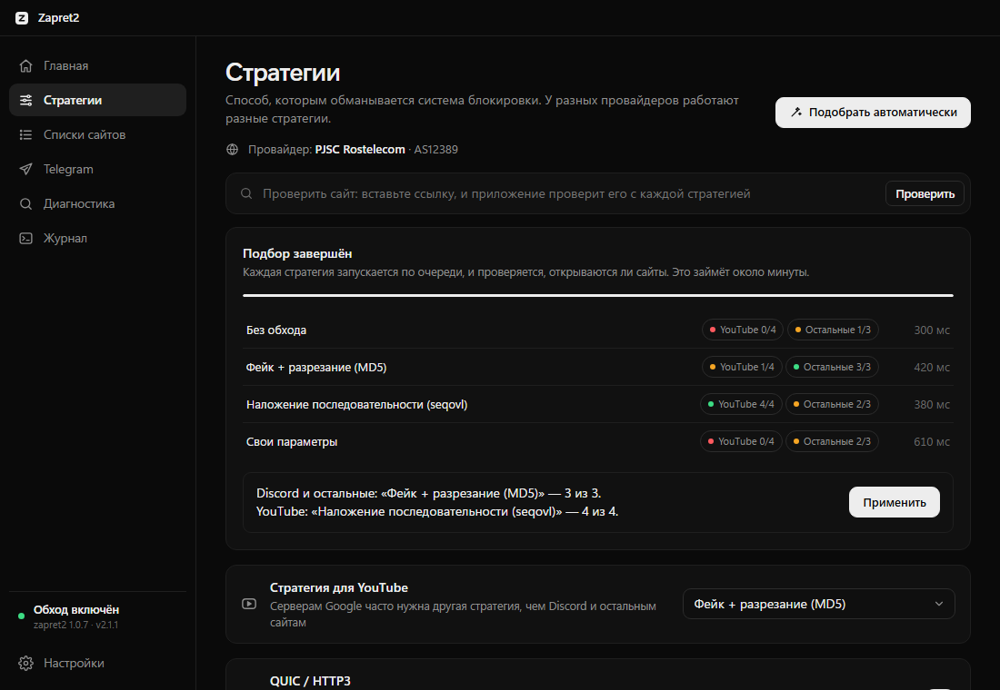
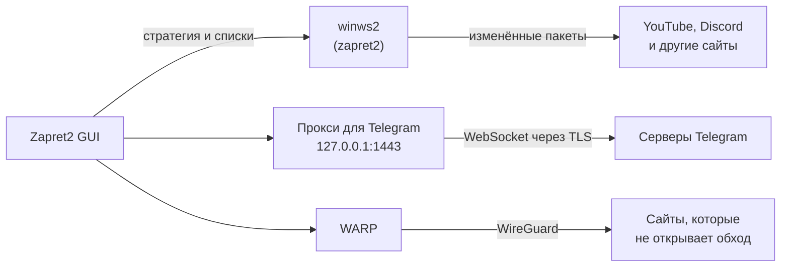

<div align="center">

<picture>
  <source media="(prefers-color-scheme: dark)" srcset="gui/screenshots/banner-dark.svg">
  
</picture>

<br><br>

[](https://github.com/raiyaxkrash/zapret2-rust/releases/latest)

[](https://github.com/raiyaxkrash/zapret2-rust/releases/latest)
[](https://github.com/raiyaxkrash/zapret2-rust/tree/stats)
[](https://github.com/raiyaxkrash/zapret2-rust/actions)
[](https://github.com/raiyaxkrash/zapret2-rust/stargazers)
[](https://t.me/raygit)

**[Возможности](#что-умеет)** · **[Сравнение](#чем-отличается)** · **[Установка](#установка)** · **[Вопросы](#вопросы-и-ответы)** · **[English](README.en.md)**

<br>

<picture>
  <source media="(prefers-color-scheme: dark)" srcset="gui/screenshots/main-dark.png">
  
</picture>

<sub>Ставите, отмечаете, что не открывается, — дальше программа всё делает сама.</sub>

</div>

<br>

## Что умеет

<table>
  <tr>
    <td width="33%" valign="top">
      <br>
      <h3>Одна кнопка</h3>
      Нажали на сферу — YouTube, Discord и выбранные сайты открываются. Нажали ещё раз — всё как было. Работает и из мини-окна в трее.
    </td>
    <td width="33%" valign="top">
      <br>
      <h3>Настраивается сама</h3>
      Мастер спросит, что не открывается, и за минуту подберёт стратегию под вашего провайдера. Поменяет провайдер блокировку — сторож заметит и подберёт заново.
    </td>
    <td width="33%" valign="top">
      <br>
      <h3>Помнит каждую сеть</h3>
      Дома одна стратегия, через раздачу с телефона другая. Перешли в другую сеть — нужная включается сама, а прежние можно вернуть из истории.
    </td>
  </tr>
  <tr>
    <td width="33%" valign="top">
      <br>
      <h3>Туннель WARP</h3>
      Для сайтов, которые провайдер блокирует так, что обход их не открывает. Через туннель идут только выбранные сайты — в браузере и в программах.
    </td>
    <td width="33%" valign="top">
      <br>
      <h3>Telegram без настроек</h3>
      Встроенный прокси для Telegram Desktop. Одна кнопка «Подключить в Telegram» — и приложение работает даже там, где не подключается напрямую.
    </td>
    <td width="33%" valign="top">
      <br>
      <h3>Видно, что происходит</h3>
      Доступность сервисов и график трафика на главной. Диагностика скажет, что мешает: подмена DNS, блокировка по IP или сам сервис.
    </td>
  </tr>
</table>

<details>
<summary><b>Всё, что внутри</b></summary>

<br>

**Открывает**
- YouTube (включая QUIC), Discord с голосовыми каналами, Telegram Desktop.
- Наборы сайтов одной кнопкой: Telegram, Instagram и Facebook, X (Twitter), торрент-трекеры, Roblox, Signal, LinkedIn, игры и лаунчеры (Steam, Epic Games, Riot, Ubisoft, EA, GOG, FACEIT), Twitch.
- Зарубежные хостинги и CDN: сайты и игры на Cloudflare, Hetzner, DigitalOcean, OVH, AWS, которые грузятся бесконечно.
- Любой свой сайт: вставьте ссылку, и он попадёт в обход.
- Через WARP: любые свои сайты, которые не открывает обход. WARP сам подбирает способ, который пропускает ваш провайдер.

**Следит сама**
- Автоподбор на настоящих сайтах, отдельная стратегия для YouTube.
- Сторож раз в 15 минут проверяет сервисы и переподбирает стратегию; если стало хуже — возвращает прежнюю.
- Своя стратегия для каждой сети и подсказки для провайдера по отчётам других пользователей.

**Удобно**
- Обновляет себя, стратегии, списки сайтов и сам zapret2.
- Запуск с Windows без запроса прав при каждом входе, мини-окно в трее.
- Простой режим для новичков, всё остальное — в «Режиме для опытных».
- Работает рядом с zapret-discord-youtube и GoodbyeDPI, переносит ваши списки из них.
- Строгий чёрно-белый дизайн, тёмная и светлая тема, русский и английский язык.
- Windows 10 и 11, в том числе на ARM64 (Snapdragon).
</details>

## Как выглядит

<table>
  <tr>
    <td width="50%"></td>
    <td width="50%"></td>
  </tr>
  <tr>
    <td align="center"><sub><b>Мастер первого запуска</b><br>отметьте, что не открывается</sub></td>
    <td align="center"><sub><b>Автоподбор</b><br>YouTube и остальные сервисы отдельно</sub></td>
  </tr>
  <tr>
    <td></td>
    <td></td>
  </tr>
  <tr>
    <td align="center"><sub><b>WARP</b><br>туннель для заблокированных сайтов</sub></td>
    <td align="center"><sub><b>Диагностика</b><br>что именно мешает и что делать</sub></td>
  </tr>
  <tr>
    <td></td>
    <td></td>
  </tr>
  <tr>
    <td align="center"><sub><b>Наборы сайтов</b><br>включаются одной кнопкой</sub></td>
    <td align="center"><sub><b>Telegram</b><br>подключение одной кнопкой</sub></td>
  </tr>
</table>

## Чем отличается

Внутри работает тот же [zapret2](https://github.com/bol-van/zapret2) от bol-van, что и в популярных сборках. Разница — в том, сколько приходится делать руками.

| | **Zapret2 GUI** | zapret-discord-youtube | GoodbyeDPI |
| :-- | :-: | :-: | :-: |
| Как управлять | окно и трей | `.bat`-файлы и консоль | `.cmd`-файлы и консоль |
| Подбор стратегии | сам подбирает и применяет | тест в консоли, `.bat` выбираете сами | режим выбираете сами |
| Переподбор, когда провайдер меняет блокировку | ✓ сторож | — | — |
| Своя стратегия для каждой сети | ✓ | — | — |
| Туннель WARP для заблокированных сайтов | ✓ встроен | — | — |
| Прокси для Telegram Desktop | ✓ встроен | — | — |
| Диагностика: что мешает и что делать | ✓ | проверка конфликтов | — |
| Обновления | сами: программа, стратегии, списки | проверка версии, скачивание вручную | вручную |

<sub>Уже пользуетесь одной из них? Zapret2 GUI работает рядом: WARP и прокси для Telegram доступны сразу, а при включении своего обхода программа предложит отключить службу другой программы (её можно вернуть) и перенесёт ваши сайты.</sub>

## Установка

<table>
  <tr>
    <td width="33%" valign="top">
      <h3>1 · Скачайте</h3>
      <code>Zapret2.GUI_X.Y.Z_x64-setup.exe</code> со <a href="https://github.com/raiyaxkrash/zapret2-rust/releases/latest">страницы релизов</a>.
    </td>
    <td width="33%" valign="top">
      <h3>2 · Запустите</h3>
      Разрешите права администратора: без них Windows не загрузит сетевой драйвер.
    </td>
    <td width="33%" valign="top">
      <h3>3 · Отметьте</h3>
      Что у вас не открывается, и нажмите «Настроить». Через минуту всё работает.
    </td>
  </tr>
</table>

При первом запуске программа сама скачает [zapret2](https://github.com/bol-van/zapret2) с GitHub и проверит его по контрольным суммам.

> [!NOTE]
> **Почему ругается антивирус?** Внутри работает драйвер перехвата пакетов WinDivert — тот же, что в GoodbyeDPI и сборках zapret. Часть антивирусов помечает его как «потенциально нежелательный», хотя это не вирус. [Проверка на VirusTotal](https://www.virustotal.com/gui/file/a7f73e997a1ea0374df15f16ac98f4400e6b81aabc377842ca2f31cc8728e76f): Microsoft Defender, ESET, Dr.Web, BitDefender и Malwarebytes угроз не находят.
>
> Установщик собирается автоматически на GitHub Actions из открытого кода этого репозитория — журнал каждой сборки на вкладке [Actions](https://github.com/raiyaxkrash/zapret2-rust/actions).

## Как это работает



- **Обход блокировок.** zapret2 слегка изменяет первые пакеты соединения, и система блокировки провайдера перестаёт их узнавать. Сайты открываются напрямую — без VPN и без потери скорости.
- **Telegram.** Отдельный встроенный прокси передаёт трафик Telegram Desktop через WebSocket, обход для этого не нужен.
- **WARP.** Сайты, которые провайдер блокирует целиком, идут через бесплатный туннель Cloudflare. Программа сама подбирает, как скрыть WARP от провайдера, и проверяет, что через туннель действительно идут данные. Браузер узнаёт о туннеле из системных настроек прокси, а соединения программ перехватываются тем же драйвером, что и у zapret2.

## Вопросы и ответы

<details>
<summary><b>YouTube не работает, а Discord работает</b></summary>

Серверам Google часто нужна другая стратегия. Нажмите «Подобрать стратегию» в мини-окне трея или пройдите мастер заново (Настройки → «Мастер настройки»): подбор выставит отдельную стратегию для YouTube. В режиме для опытных можно выключить **QUIC / HTTP3** на странице «Стратегии» и повторить подбор.
</details>

<details>
<summary><b>Что-то не открывается, и непонятно почему</b></summary>

Откройте «Диагностика» → «Проверить». Программа покажет, что именно мешает (подмена DNS, блокировка по IP, обрыв соединения или ограничение самого сервиса), и подскажет, что делать. Отчёт можно скопировать и приложить к issue.
</details>

<details>
<summary><b>ChatGPT, Claude или Spotify пишут, что недоступны в вашей стране</b></summary>

Эти сервисы сами закрыли доступ из России и проверяют страну по адресу. Обход блокировок тут не поможет, WARP тоже: Cloudflare намеренно показывает сайтам настоящую страну пользователя. Нужен VPN с сервером за границей. Zapret2 GUI работает рядом с ним, но при включённом VPN обход не нужен: трафик и так уходит за границу.
</details>

<details>
<summary><b>Как подключить приложение Telegram?</b></summary>

Включите «Прокси для Telegram» на главной, откройте раздел «Telegram» и нажмите «Подключить в Telegram»: Telegram Desktop сам предложит добавить прокси, это нужно сделать один раз. Прокси работает отдельно от обхода, его можно включить, даже если обход выключен.
</details>

<details>
<summary><b>У меня уже стоит zapret-discord-youtube или GoodbyeDPI</b></summary>

Два обхода DPI одновременно не работают: каждый пакет менялся бы дважды. Zapret2 GUI работает рядом с ними — WARP и прокси для Telegram доступны сразу. Когда вы включите обход Zapret2, программа предложит отключить службу другой программы (она перестанет запускаться с Windows) и перенесёт ваши списки сайтов. Вернуть службу можно в Настройках → Дополнительно.
</details>

<details>
<summary><b>Некоторые сайты или игры грузятся бесконечно</b></summary>

Часто это сайты на зарубежных хостингах (Cloudflare, Hetzner, AWS и другие): соединение с ними обрывается после первых килобайт. Включите набор «Зарубежные хостинги и CDN» на странице «Списки сайтов». Для игр есть отдельный набор «Игры и лаунчеры».
</details>

<details>
<summary><b>Где стратегии и журнал?</b></summary>

Новые пользователи видят простой режим: главная, наборы сайтов, Telegram, WARP и диагностика. Стратегии, журнал, порты и другие тонкие настройки появятся, если включить Настройки → Оформление → «Режим для опытных».
</details>

<details>
<summary><b>Зачем нужны права администратора?</b></summary>

zapret2 перехватывает сетевые пакеты через драйвер WinDivert, а загружать драйверы в Windows может только администратор. Автозапуск сделан через Планировщик заданий, поэтому запрос UAC при каждом входе не появляется.
</details>

<details>
<summary><b>Windows 11 на ARM64 (Snapdragon)</b></summary>

Подписанного драйвера WinDivert для ARM64 не существует. Приложение само подкладывает неподписанный ARM64-драйвер из набора автора zapret, но Windows загрузит его только в **режиме тестовой подписи**: выключите Secure Boot в настройках UEFI, нажмите «Включить тестовый режим» на главном экране и перезагрузите компьютер. Отключить режим можно командой `bcdedit /set {current} testsigning off`.
</details>

<details>
<summary><b>Где хранятся настройки и как удалить?</b></summary>

Настройки и списки лежат в `%LOCALAPPDATA%\Zapret2GUI` (Настройки → «Папка с данными»). Удаляется программа через «Параметры Windows» → «Приложения», вместе с заданием автозапуска.
</details>

Не нашли ответа? [Создайте issue](https://github.com/raiyaxkrash/zapret2-rust/issues/new/choose) и приложите отчёт диагностики или напишите в Telegram-канал [@raygit](https://t.me/raygit) — там же новости и анонсы новых версий.

## Помочь проекту

<table>
  <tr>
    <td width="33%" valign="top">
      <h3>Поделитесь стратегией</h3>
      После подбора нажмите «Поделиться результатом». Из таких отчётов собираются подсказки для каждого провайдера.
    </td>
    <td width="33%" valign="top">
      <h3>Предложите сайт</h3>
      Не хватает сайта во встроенных наборах? Заполните <a href="https://github.com/raiyaxkrash/zapret2-rust/issues/new?template=site.yml">короткую форму</a>.
    </td>
    <td width="33%" valign="top">
      <h3>Поставьте звезду ⭐</h3>
      Так проект проще найти тем, у кого тоже ничего не открывается.
    </td>
  </tr>
</table>

<details>
<summary><b>Для разработчиков</b></summary>

<br>

| Путь | Что там |
| --- | --- |
| [`gui/`](gui/) | Приложение: Rust (Tauri 2) и интерфейс на HTML/CSS. Сборка, стратегии и выпуск версий — в [gui/README.md](gui/README.md) |
| [`gui/resources/presets.json`](gui/resources/presets.json) | Стратегии и наборы сайтов. Изменения доходят до установленных копий без нового релиза |
| [`gui/resources/lists/`](gui/resources/lists/) | Встроенные списки доменов и подсетей |
| [`gui/ui/i18n.js`](gui/ui/i18n.js) | Английский перевод интерфейса |
| [`gui/scripts/`](gui/scripts/) | Выпуск версий и обновление списка подсетей хостингов |
| [`.github/workflows/release.yml`](.github/workflows/release.yml) | Тесты, сборка и публикация подписанных релизов по тегу `vX.Y.Z` |
| [`.github/workflows/stats.yml`](.github/workflows/stats.yml) | Ежедневная статистика по счётчикам скачиваний GitHub (без телеметрии) — ветка [`stats`](https://github.com/raiyaxkrash/zapret2-rust/tree/stats) |

Сборка: нужны Rust (MSVC), Visual Studio Build Tools (C++) и Node.js.

```bash
cd gui
npm install
npm run build
```

zapret2 в репозиторий и установщик не входит: приложение скачивает его из [релизов bol-van/zapret2](https://github.com/bol-van/zapret2/releases). Параметры winws2 описаны в [manual.md](https://github.com/bol-van/zapret2/blob/master/docs/manual.md).
</details>

## Благодарности

- [**zapret2**](https://github.com/bol-van/zapret2) и [zapret-win-bundle](https://github.com/bol-van/zapret-win-bundle) от **bol-van** — движок обхода и ARM64-драйвер (MIT).
- [**tg-ws-proxy**](https://github.com/Flowseal/tg-ws-proxy) от **Flowseal** — протокол, на котором основан прокси для Telegram (MIT).
- [WinDivert](https://reqrypt.org/windivert.html) — драйвер перехвата пакетов. [Tauri](https://tauri.app) — основа приложения. [Cloudflare WARP](https://one.one.one.one/) — бесплатный туннель.

<br>

<div align="center">
<br>
<sub>Сделано для тех, кому просто нужно, чтобы всё открывалось.</sub>
</div>
