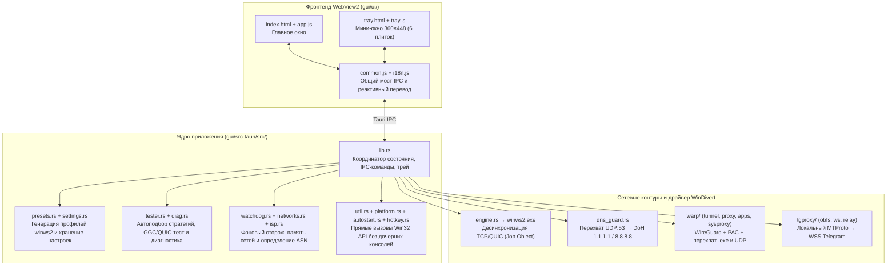

<div align="center">


# Zapret2 GUI — Техническая документация

**Нативная графическая оболочка и сетевой комбайн на Rust + Tauri 2 для Windows 10 / 11 (x64 и ARM64)**


**[Архитектура](#архитектура)** · **[Модули Rust](#карта-модулей-rust)** · **[Производительность](#производительность-и-системная-интеграция)** · **[Хранение и Portable](#хранение-данных-и-портативный-режим)** · **[Стратегии и пресеты](#стратегии-и-облачные-пресеты)** · **[Сборка и релиз](#сборка-тесты-и-выпуск-релиза)**

</div>

---

## Обзор

В каталоге `gui/` располагается исходный код десктопного приложения **Zapret2 GUI**. Приложение управляет внешним процессом `winws2.exe` из проекта [bol-van/zapret2](https://github.com/bol-van/zapret2) (скачивая и проверяя его по SHA-256 при первом старте) и одновременно содержит три собственных высокопроизводительных сетевых движка в едином исполняемом файле Rust:

1. **Клиент Cloudflare WARP в пространстве пользователя** (`boringtun` + `smoltcp` + локальный HTTP/SOCKS5/PAC-прокси + прозрачный перехватчик `.exe`-процессов и голосового/игрового UDP через WinDivert).
2. **Локальный MTProto-прокси поверх WebSocket/TLS** для Telegram Desktop (`127.0.0.1:1443`) с автоматическим переключением на резервные релеи Cloudflare.
3. **Прозрачный перехватчик DNS-over-HTTPS (`DnsGuard`)**, защищающий системные запросы `UDP:53` от подмены провайдером через `1.1.1.1` и `8.8.8.8` (RFC 8484) с локальным TTL-кэшем.

---

## Архитектура



### Совместная работа нескольких фильтров WinDivert

В системе могут одновременно работать `DnsGuard`, перехватчик программ `warp::apps` и процесс `winws2.exe`. Чтобы пакеты не зацикливались и каждый слой видел чистые данные, приоритеты WinDivert разведены строго по уровням:

| Компонент | Слой WinDivert | Приоритет | Поведение |
| :--- | :--- | :---: | :--- |
| **`dns_guard.rs`** (входящая инжекция) | `NETWORK` | `1100` | Впрыскивает чистый DNS-ответ выше остальных фильтров, чтобы `warp::apps` тоже увидел неискажённые IP-адреса доменов |
| **`dns_guard.rs`** (перехват запроса) | `NETWORK` | `820` | Перехватывает публичные запросы `outbound udp.DstPort == 53`, разрешает через DoH и кэширует по минимальному TTL ответа |
| **`warp/apps.rs`** (сокеты `.exe`) | `SOCKET` (sniff) | `760` | Отслеживает `bind`/`connect` выбранных `.exe`-программ и сопоставляет локальные порты без блокировки ядра |
| **`warp/apps.rs`** (перенаправление) | `NETWORK` | `750` | Заворачивает TCP:80/443 целевых подсетей и весь TCP + игровой/голосовой UDP выбранных `.exe` в туннель WARP |
| **`winws2.exe`** | `NETWORK` | `0` *(по умолч.)* | Модифицирует первые пакеты прямых соединений, не затронутых туннелем WARP |

---

## Карта модулей Rust

Все модули бэкенда находятся в [`src-tauri/src/`](src-tauri/src/):

| Модуль | Ответственность |
| :--- | :--- |
| [`lib.rs`](src-tauri/src/lib.rs) | Точка входа Tauri, состояние `AppState`, обработчики всех IPC-команд, системный трей (левый/средний/двойной клик), сохранение геометрии окна, экспорт/импорт резервных копий |
| [`engine.rs`](src-tauri/src/engine.rs) | Запуск и остановка `winws2.exe`, привязка к Windows Job Object (`JOB_OBJECT_LIMIT_KILL_ON_JOB_CLOSE`), потоковое чтение `stdout`/`stderr`, автоперезапуск при падении (до 3 раз за 5 минут) |
| [`presets.rs`](src-tauri/src/presets.rs) | Загрузка `presets.json`, сборка многопрофильной командной строки `winws2` (раздельные профили для YouTube, Discord, голоса Discord, наборов `packs`, подсетей `ipset` и блокировки QUIC) |
| [`tester.rs`](src-tauri/src/tester.rs) | Параллельный автоподбор стратегий с чтением минимум 64 КБ (ловит отсечки ТСПУ на 16 КБ), проверка редиректора видеопотока Google (`redirector.googlevideo.com`) и автоматический дотест лучших кандидатов с выключенным QUIC |
| [`dns_guard.rs`](src-tauri/src/dns_guard.rs) | Прозрачный перехватчик `UDP:53` → RFC 8484 DoH (`https://1.1.1.1/dns-query`, `https://8.8.8.8/dns-query`), синтез IPv4+UDP-ответов с расчётом контрольных сумм и пропуском локальных имён (`.local`, `.lan`, `arpa`) |
| [`warp/mod.rs`](src-tauri/src/warp/mod.rs) | Управление жизненным циклом Cloudflare WARP, автоподбор маскировки (`junk`, `dns`, `quic`, `plain`), привязка ключа WARP+ и перевыпуск аккаунта |
| [`warp/tunnel.rs`](src-tauri/src/warp/tunnel.rs) | Пользовательский стек `boringtun` (WireGuard) + `smoltcp` (TCP/UDP стек в памяти) с мультиплексированием потоков и чистым закрытием сессии |
| [`warp/apps.rs`](src-tauri/src/warp/apps.rs) | Перехват трафика десктопных приложений через WinDivert: отслеживание DNS-ответов (`A` + `CNAME`), фильтрация по именам `.exe` на уровне сокетов и NAT-таблица для TCP и UDP |
| [`warp/proxy.rs`](src-tauri/src/warp/proxy.rs) | Локальный HTTP `CONNECT` / SOCKS5 прокси-сервер, генератор PAC-скрипта по списку доменов и резервное разрешение имён через DoH |
| [`warp/sysproxy.rs`](src-tauri/src/warp/sysproxy.rs) | Установка `AutoConfigURL` в реестре Windows с уведомлением WinINET и восстановлением исходного состояния даже после аварийного завершения |
| [`tgproxy/`](src-tauri/src/tgproxy/) | Реализация протокола MTProto-over-WebSocket (`obfs.rs`, `ws.rs`, `relay.rs`) для прямого подключения Telegram Desktop без внешнего Python/exe |
| [`diag.rs`](src-tauri/src/diag.rs) | Параллельная диагностика связи, отравления DNS, блокировок по IP, обрывов DPI и региональных ограничений с возвратом интерактивных кодов действий |
| [`watchdog.rs`](src-tauri/src/watchdog.rs) | Фоновая проверка доступности каждые 15 минут с защитой от ложных срабатываний, автопереподбором и откатом при ухудшении результата |
| [`networks.rs`](src-tauri/src/networks.rs) | Отпечаток текущей сети (шлюз + ASN) и история рабочих стратегий с автоматическим переключением при смене Wi-Fi или модема |
| [`hotkey.rs`](src-tauri/src/hotkey.rs) | Отдельный лёгкий поток Win32 (`RegisterHotKey` + `GetMessageW`) для глобальной комбинации `Ctrl+Shift+Z` |
| [`util.rs`](src-tauri/src/util.rs) | Снимок процессов через `CreateToolhelp32Snapshot` (`<0.2 мс`), прямое чтение/запись реестра (`winreg`), IDN Punycode через `IdnToAscii`, нормализация доменов и `.exe` |
| [`paths.rs`](src-tauri/src/paths.rs) | Управление директориями данных, определение портативного режима, синхронизация встроенных списков и подстановка ARM64-драйвера |
| [`zapret_update.rs`](src-tauri/src/zapret_update.rs) | Загрузка релизов `bol-van/zapret2` с верификацией контрольных сумм SHA-256 архива и каждого извлекаемого бинарного файла |

---

## Производительность и системная интеграция

- **Нулевая нагрузка на GPU в фоне:** интерфейс построен на строгой монохромной палитре (`#0a0a0a` / `#fafafa`) без `backdrop-filter: blur` и бесконечных CSS-анимаций. При сворачивании окна или закрытии в трей класс `html.paused` и обёртка `everyWhileVisible` полностью останавливают таймеры опроса и отрисовку SVG-графика трафика.
- **Отказ от порождения консольных утилит:** проверка запущенных процессов, конфликтующих служб, темы/языка Windows и системного прокси выполняется прямыми вызовами `windows-sys` (`CreateToolhelp32Snapshot`, `RegGetValueW`, `RegSetValueExW`) вместо медленных вызовов `tasklist.exe` и `reg.exe`.
- **Автозапуск без окон UAC:** в [`autostart.rs`](src-tauri/src/autostart.rs) задание регистрируется в Планировщике заданий Windows с уровнем прав `HighestAvailable` и 30-секундным кэшированием статуса.
- **Надёжное завершение:** дочерний процесс `winws2.exe` помещается в системный Job Object, поэтому ядро Windows гарантированно выгружает его даже при принудительном завершении GUI через Диспетчер задач.

---

## Хранение данных и портативный режим

По умолчанию рабочие файлы хранятся в `%LOCALAPPDATA%\Zapret2GUI`.
Если рядом с `zapret2-gui.exe` создать пустой файл **`portable`** или **`portable.txt`**, приложение автоматически переключится в **портативный режим** и будет хранить все данные в папке `<папка_программы>\data\`.

| Относительный путь | Назначение |
| :--- | :--- |
| `settings.json` | Все настройки приложения, список своих доменов/программ WARP и сохранённые координаты окна |
| `networks.json` | История стратегий для каждой обнаруженной сети |
| `warp.json` / `warp-route.json` | Ключи устройства WireGuard и найденный способ маскировки WARP |
| `engine\` | Загруженный `winws2.exe`, `WinDivert64.sys`, Lua-скрипты десинхронизации и бинарные фейки |
| `lists\user.txt` | Пользовательский список «Мои сайты» |
| `lists\exclude.txt` | Пользовательский список исключений |
| `lists\packs\*.txt` | Встроенные и обновляемые списки доменов/подсетей для наборов сервисов |
| `remote\` | Кэш обновлённых из облака `presets.json` и базовых списков |

> [!NOTE]
> Автоматически пополняемый список `autohostlist.txt` всегда располагается в `%USERPROFILE%\AppData\LocalLow\Zapret2GUI\autohostlist.txt`, поскольку после инициализации драйвера `winws2.exe` сбрасывает свои привилегии до уровня `Low Integrity` и имеет право записи только в каталог `LocalLow`.

---

## Windows 11 ARM64

На устройствах с процессорами Snapdragon x64-бинарник приложения и `winws2.exe` прозрачно исполняются встроенным эмулятором Windows 11, однако драйвер ядра обязан соответствовать архитектуре ОС:

1. В ресурсы приложения включён ARM64-драйвер `resources/arm64/WinDivert64.sys` из официального пакета [zapret-win-bundle](https://github.com/bol-van/zapret-win-bundle/tree/master/arm64).
2. На ARM64-системах метод `Paths::apply_arm64_driver()` автоматически заменяет `engine\bin\WinDivert64.sys` при установке и после каждого обновления `zapret2`.
3. Поскольку цифровой подписи Microsoft WHQL для ARM64-сборки WinDivert не существует, интерфейс проверяет состояние `testsigning` и `Secure Boot`, предлагая включить тестовый режим подписи одной кнопкой с подробным пояснением.

---

## Стратегии и облачные пресеты

Все стратегии, наборы сайтов (`packs`) и стартовые подсказки для провайдеров (`isp`) описаны в [`resources/presets.json`](resources/presets.json).

### Бесшовное обновление без перевыпуска установщика
Установленные копии приложения периодически сверяют поле `"version"` в `gui/resources/presets.json` из ветки `main` на GitHub:
1. Внесите правки в `resources/presets.json` или списки `resources/lists/`.
2. Увеличьте целочисленное поле `"version"` на `1`.
3. Проверьте полноту английского перевода новых названий и описаний командой `node scripts/check-i18n.mjs`.
4. Отправьте изменения в `main` — пользователи получат новые стратегии и списки автоматически или по кнопке «Обновить».

### Локализация интерфейса (`ui/i18n.js`)
Интерфейс проектируется на русском языке, а перевод на английский работает через лёгкий реактивный словарь `D` в [`ui/i18n.js`](ui/i18n.js) с `MutationObserver` и поддержкой шаблонов `{}`. Любая новая строка в HTML, JS, `presets.json` или пользовательских ошибках Rust добавляется в `ui/i18n.js` и автоматически проверяется скриптом [`scripts/check-i18n.mjs`](scripts/check-i18n.mjs).

---

## Сборка, тесты и выпуск релиза

### Требования к окружению
- **Rust** (`stable-x86_64-pc-windows-msvc`)
- **Visual Studio Build Tools** с компонентом *Desktop development with C++*
- **Node.js** 20 LTS или новее

### Локальная проверка и сборка

```powershell
# 1. Установка CLI-инструментов Tauri
cd gui
npm install

# 2. Проверка полноты английской локализации
node scripts/check-i18n.mjs

# 3. Строгая проверка анализатором Clippy и запуск модульных тестов Rust
cd src-tauri
cargo clippy --lib --tests -- -D warnings
cargo test --lib
cd ..

# 4. Сборка релизного NSIS-установщика
npm run build
```

Готовый установщик создаётся по пути `gui/src-tauri/target/release/bundle/nsis/`.

### Публикация подписанного релиза

Для работы встроенного автообновления используется приватный ключ подписи Tauri (`gui/.keys/zapret2gui.key`, хранящийся в секрете репозитория `TAURI_SIGNING_PRIVATE_KEY`):

```powershell
# 1. Создайте описание изменений релиза (необязательно)
#    gui/release-notes/2.7.0.md

# 2. Синхронно обновите версию в Cargo.toml, tauri.conf.json и package.json + создайте git-тег
.\gui\scripts\bump-version.ps1 2.7.0 -Tag

# 3. Отправьте ветку и тег — GitHub Actions выполнит тесты и опубликует релиз с latest.json
git push origin main v2.7.0
```
